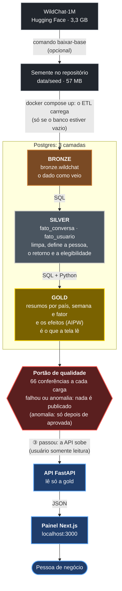

# Retenção de um assistente de IA: análise e dashboard

Desafio técnico (Acaso): **o que faz quem experimentou o assistente voltar a usá-lo em até 7 dias**, com o efeito de cada fator, a incerteza e a separação entre causa e seleção.
Base: WildChat-1M (análise sobre `country = 'Brazil'`; o dashboard tem filtro de país).

**Resultado em uma linha:** no Brasil, **23,7% voltam em até 7 dias** (IC 95%: 22,0% a 25,5%). Quem abre a conversa só com uma saudação volta ~8 pp menos e quem recebe uma recusa na primeira resposta, ~10 pp menos;
trocar de modelo ou alongar a resposta não mostra ganho. É associação ajustada, não prova de causa.

Este README é o guia único do projeto, na ordem em que você vai precisar dele. O resumo formal da entrega (achados, decisões, uso de IA) está em [`docs/DOCUMENTO.md`](docs/DOCUMENTO.md).

## Sumário
1. [As armadilhas do enunciado](#1-as-armadilhas-do-enunciado-e-como-foram-tratadas)
2. [Subir do zero e usar](#2-subir-do-zero-e-usar)
3. [Como o projeto funciona de ponta a ponta](#3-como-o-projeto-funciona-de-ponta-a-ponta)
4. [As camadas: Bronze, Silver, Gold e Efeitos](#4-as-camadas-bronze-silver-gold-e-efeitos)
5. [Definições e premissas](#5-definições-e-premissas)
6. [Conectar no banco e validar com SQL](#6-conectar-no-banco-e-validar-com-sql)
7. [Testes automáticos](#7-testes-automáticos)
8. [Monitoramento e prevenção de divergências](#8-monitoramento-e-prevenção-de-divergências)
9. [API, telas e desempenho](#9-api-telas-e-desempenho)
10. [Decisões registradas](#10-decisões-registradas)
11. [Incidente, riscos e AWS](#11-incidente-riscos-e-aws)
12. [Dados, licença, privacidade e uso de IA](#12-dados-licença-privacidade-e-uso-de-ia)
13. [Limites conhecidos e extensões](#13-limites-conhecidos-e-extensões)
14. [Estrutura do repositório](#14-estrutura-do-repositório)

---

## 1. As armadilhas do enunciado e como foram tratadas
O PDF esconde seis cuidados que mudam o número. Os limites do que foi feito estão na [seção 13](#13-limites-conhecidos-e-extensões).

1. **`timestamp` é o último turno, não o início:** o início é a 1ª resposta do assistente (`primeira_resposta_ts`); testado em `test_incidente.py`.
2. **`conversation_hash` não é chave única:** só a cópia exata (hash + IP + início) é removida; o mesmo hash com IP ou início diferente é outra conversa.
3. **Não há ID de usuário; IP compartilhado:** usuário = IP + família do navegador/sistema, sem versão (só IP: 23,7%; user-agent completo: 26,2%).
4. **Censura à direita e à esquerda:** elegível = 1ª vez 30 dias depois do início dos dados e 7 dias antes do fim.
5. **O retorno exclui a própria sessão:** sessão nova só se passam mais de 30 minutos do fim da conversa anterior.
6. **Fuso:** o dia e a semana contam em America/Sao_Paulo (UTC no banco).

---

## 2. Subir do zero e usar
Requisitos: Docker e Docker Compose (não precisa de Python nem de baixar a base).
```bash
docker compose up --build
```
Tela: http://localhost:3000 · API (documentação): http://localhost:8000/docs · banco: `localhost:5433`.
A carga leva de 2 a 3 minutos na primeira vez (inclui o build). Se uma conferência falhar, a carga é revertida e nada é publicado.
**Os dados ficam guardados no banco** (volume `pgdata`). Nas vezes seguintes o `docker compose up` **não recarrega nada**: o ETL vê que o banco já está carregado e sai na hora, e a tela sobe em segundos. O ETL só roda de novo se o banco estiver vazio, se a semente mudou ou se você pedir:
```bash
docker compose run --rm etl python main.py --recarregar     # refaz a carga (2 a 3 minutos); use depois de mudar o ETL ou as migrações
docker compose down -v                                       # derruba e apaga o banco; o próximo up carrega do zero
```
**Depois de mudar o código, use sempre `--build`**; sem ele o Compose reaproveita as imagens antigas.

**Quando o ETL retém a carga (anomalia).** A cada carga, o ETL compara os números novos com os da carga anterior. Se o detector achar uma **anomalia** (a taxa de retorno de algum país mudou 5 p.p. ou mais, ou uma semana teve um pico novo), a carga fica **retida**: **nada é publicado** e o painel continua com os números anteriores, até alguém decidir. Assim uma mudança estranha nos dados nunca "bagunça" os números do cliente sem ninguém ver.

| Situação | O que acontece | Status em `ops.etl_execucao` |
|---|---|---|
| Uma conferência de conservação falha (ou um dos números do Brasil conferidos à mão) | a carga é desfeita (rollback); os dados anteriores ficam | `falhou` |
| O detector acha anomalia | a carga é **retida** (também desfeita) e espera a sua decisão | `retida` |
| Você aprova a anomalia | a carga é refeita e publicada, com o registro do que foi aprovado | `alerta` |
| Nada de estranho | a carga é publicada | `ok` |

```bash
docker compose --profile operacao run --rm investigar-anomalias            # o que mudou e de qual camada veio
docker compose run --rm etl python main.py --aprovar-anomalias             # é mudança real: refaz a carga e publica
docker compose run --rm etl python main.py --recarregar                    # era defeito: corrija a causa e refaça, sem aprovar
```
Com uma carga retida, o `docker compose up` não a repete ("nada a fazer, há uma carga retida aguardando aprovação"); uma semente nova, `--recarregar` ou `--aprovar-anomalias` refazem a tentativa. `GET /api/saude` devolve a carga publicada (`ultima_execucao_etl`) e, se houver, a retida (`carga_retida`). A **primeira** carga de um banco vazio nunca é retida (não há com o que comparar). O ETL sai com código 0 mesmo retida, para o painel continuar de pé com os números anteriores; no desenho da AWS, um alarme sobre o status `retida` avisaria o time (não implementado).

**O que o `docker compose up` executa, em ordem**

| Serviço | O que faz | Termina? |
|---|---|---|
| `db` | Postgres 16 vazio; espera ficar saudável | não |
| `etl` | Roda `etl/main.py`: migra o banco e, **só se ele estiver vazio** (ou a semente mudou), carrega a semente (bronze), limpa e deriva (silver), resume e estima efeitos (gold), confere tudo e publica | **sim** (código 0 = ok ou nada a fazer, 1 = portão falhou) |
| `api` | FastAPI somente leitura; **só sobe se o ETL terminou bem** | não |
| `web` | Dashboard Next.js; fala com a API pelo mesmo domínio (`/api/*`) | não |

**Acesso (nenhuma senha fica no repositório).** Sem configurar nada, existe a conta `avaliacao@exemplo.com`, com **senha aleatória gerada na primeira subida e mostrada uma vez no log**:
```bash
docker compose logs etl | findstr SENHA      # Windows
docker compose logs etl | grep SENHA          # Linux e macOS
```
Para usar o seu e-mail e senha: copie `.env.example` para `.env`, preencha `DASH_USERS` (`email|Nome|url-da-foto;email|Nome`; a foto é opcional) e `DASH_PASSWORD`, e suba de novo com `--build`. Se perder a senha gerada: `docker compose down -v` e suba de novo.

A API gera um segredo de sessão aleatório a cada subida (reiniciar encerra as sessões); em produção ele vem de `SESSION_SECRET`. As portas 3000 e 8000 abrem só em `localhost`.

**As 4 telas**
- **Visão geral:** de onde vêm os dados, 6 cartões (pessoas novas, retorno em 7 dias, conversas, recusa, voltou em 24 h, concentração), a história em 8 passos, retorno por mês com intervalo, comparação de modelos, curva de retorno, mapa de calor dia × hora, GPT-4 por mês, concentração do uso e comparação de países.
- **O que faz voltar:** efeitos de cada fator com intervalo, ordenados pelo tamanho; os 4 achados; turnos; dispositivo, sistema, navegador e idioma × navegador (exploratórios).
- **Coortes semanais:** curva de retorno (24 h, 7 e 30 dias), pessoas novas por semana, mapa de calor do retorno e a decomposição "chegou gente diferente × a mesma gente voltou diferente".
- **Ajuda:** para que serve o painel, palavras e regras, o que mostra e nunca mostra, e os problemas de qualidade dos dados.

Seletor de país, idioma (PT/EN) e tema (claro/escuro) no cabeçalho; o botão "i" de cada indicador mostra a definição e a fórmula.
Para incluir outro idioma: crie `frontend/lib/idiomas/<codigo>.ts` com as mesmas chaves de `pt.ts` (o compilador acusa chave faltando) e acrescente-o em `lib/i18n.tsx`. Textos que vêm do banco são traduzidos em `lib/traducao-dados.ts`.

**Problema de build com `SSL: UNEXPECTED_EOF`** em `files.pythonhosted.org`: é rede (VPN ou proxy), não o projeto. Tente outra rede.

---

## 3. Como o projeto funciona de ponta a ponta

O ETL (`etl/main.py`) é uma "receita" que roda **quando o banco está vazio**, quando a semente muda ou sob `--recarregar` (nos demais `docker compose up` ele sai na hora, porque o banco guarda os dados). As três camadas são **reconstruídas por inteiro, numa única transação**: a API nunca vê um estado pela metade e, se uma conferência falha, nada é publicado e o painel continua com os dados anteriores.

| # | Passo | O que acontece |
|---|---|---|
| 0 | Preparar | aplica as migrações de `db/migrations/` (só as que faltam), cria as contas de acesso, liga a trava de escrita e abre o registro da execução em `ops.etl_execucao` |
| 0b | Integridade | **antes de reconstruir**, confere se o que está publicado é idêntico ao que a carga anterior deixou (ninguém alterou por fora); só alerta |
| 1 | Bronze | confere o contrato da semente (colunas e tipos), registra os arquivos (sha256) e carrega os Parquet em `bronze.wildchat`; valida |
| 2 | Silver | limpa, define a pessoa, as visitas, o retorno e a elegibilidade; registra o que excluiu; valida |
| 3 | Gold | monta os resumos que a tela lê, estima os efeitos e valida |
| 3b/3c | Anomalias | compara a taxa de cada país e cada semana com a carga anterior e aponta a camada de origem; **se achar anomalia, retém a carga** (nada é publicado) até alguém aprovar |
| 4 | Publicar | `COMMIT` só se **todas** as conferências passaram; senão `ROLLBACK` |

Cada camada faz **limpar → construir → (auditar) → validar → medir**, e "medir" grava as medidas da camada em `auditoria.metrica` e compara com a carga anterior. Duas conexões: `ops` (cada comando vale na hora; guarda o histórico mesmo se a carga falhar) e `dw` (a transação das camadas).

### O caminho de um número: o 23,7%
1. Em `bronze.wildchat`, cada conversa do Brasil é uma linha (11.621).
2. A silver agrupa as conversas por pessoa e marca `voltou_7d` e `elegivel`: 530 voltaram, de 2.234 elegíveis.
3. A gold guarda os totais por semana e o intervalo de Wilson.
4. A API devolve esses valores e a tela mostra 23,7%, com a margem de erro e a definição no botão "i".

### Uma pessoa, passo a passo
```sql
SELECT * FROM auditoria.audite_usuario('00a3cf656f92');
```
| n | início (local) | min desde o fim anterior | sessão | dias desde a 1ª | dentro dos 7 dias | voltou (silver) | elegível |
|---|---|---|---|---|---|---|---|
| 1 | 17/02/2024 09:15 | | 1 | 0,00 | não | sim | sim |
| 2 | 22/02/2024 19:22 | 7.796 | 2 | 5,42 | **sim** | sim | sim |
| 3 | 22/02/2024 20:22 | 59 | 3 | 5,46 | sim | sim | sim |
| 4 | 25/02/2024 18:11 | 4.187 | 4 | 8,37 | não | sim | sim |

Cada intervalo passa de 30 min, então cada conversa abre uma sessão nova. A conversa 2 ocorre 5,42 dias depois da primeira, dentro dos 7: **voltou**. Troque o `usuario_id` para auditar outra pessoa.

---

## 4. As camadas: Bronze, Silver, Gold e Efeitos

### Antes do ETL: a semente
A **semente** são dois arquivos Parquet em `data/seed/` (57 MB), gerados do WildChat-1M completo:
- `wildchat_brasil.parquet`: o Brasil **completo, com o texto** (11.621 linhas, 22 MB);
- `wildchat_outros_paises.parquet`: os demais países **sem texto** (826.368 linhas, 35 MB; inclui as 1.060 linhas sem país);
- nos dois, a coluna `primeira_resposta_ts`: o horário da 2ª mensagem (a 1ª resposta do assistente).

**Refazer a semente a partir da fonte (opcional).** Um comando baixa o WildChat-1M do Hugging Face (público, sem login, revisão fixada), gera a semente e confere as contagens (837.989 e 11.621):
```bash
docker compose --profile base run --rm baixar-base                 # baixa e gera (data/raw e data/seed)
docker compose --profile base run --rm baixar-base --so-semente   # refaz só a semente, a partir de data/raw
docker compose run --rm etl python main.py --recarregar            # o banco passa a usar a semente nova
```
O código é [`etl/semente/baixar_base.py`](etl/semente/baixar_base.py) (só biblioteca padrão e DuckDB). **Verificado:** a partir do arquivo bruto completo, a semente regenerada é **idêntica byte a byte** à do repositório (sha256 `e81720c4…` e `77ee2c15…`); lida em vários arquivos, o conteúdo e a ordem são os mesmos (só a divisão interna em blocos muda os bytes). O download foi testado com um arquivo: **levou 9 minutos nesta máquina** (231 MB); os 14 arquivos (3,3 GB) levariam cerca de 2 horas, e por isso a semente fica no Git e é o padrão (ADR-002).
- *Por quê:* subir com um comando, sem baixar 3 GB. *Limites:* é uma foto fixa; só o Brasil tem texto, então tema, recusa e efeitos só existem para ele; o texto do Brasil está no repositório, que por isso deve ser **privado**.
### Bronze: o dado como veio
| | |
|---|---|
| **Entra** | os dois Parquet da semente |
| **Sai** | `bronze.wildchat` (837.989 linhas) e o registro dos arquivos em `ops.bronze_lote` |
| **Quem enxerga** | só o ETL |
| **Código** | [`etl/camadas/bronze/`](etl/camadas/bronze/): `contrato.py` (confere colunas e tipos antes de tudo), `registrar_lotes.py` (sha256), `limpar.py` (`TRUNCATE`), `carregar.py` (DuckDB lê o Parquet, aninhados viram JSON, vai por `COPY`), `validar.py` (5 conferências), `diagnosticar.py` |

Não limpa nem calcula nada: duplicatas e vazios continuam aqui. Todo o resto é cópia fiel; a única coluna derivada é `primeira_resposta_ts` (calculada na semente). `COPY` carrega 840 mil linhas em ~14 s.
**Conferências:** linhas da bronze = soma dos arquivos; Brasil = 11.621; nenhuma linha do Brasil veio do outro arquivo; cada conversa tem 2 × turnos mensagens.

### Silver: o dado limpo, com as regras de negócio
| | |
|---|---|
| **Entra** | `bronze.wildchat` |
| **Sai** | `silver.fato_conversa` (837.972 linhas, sem texto), `silver.fato_usuario` (197.319 pessoas), `silver.dim_pais`, `silver.dim_tema`, e o registro do que foi excluído em `auditoria.*` |
| **Código** | [`etl/camadas/silver/`](etl/camadas/silver/): `sql.py` (os comandos), `construir.py` (ordem), `auditoria.py`, `validar.py`, `recalculo_independente.py`; regras e parâmetros em [`etl/comum/definicoes.py`](etl/comum/definicoes.py) |

Todo o trabalho é SQL **dentro do Postgres** (o Python só envia os comandos), em tabelas temporárias que somem no fim da transação:
1. **Achatar** a bronze: tira navegador, idioma do navegador, pedido e resposta do JSON; país vazio vira "Desconhecido"; **início** = 1ª resposta do assistente, **fim** = `timestamp` (último turno).
2. **Limpar:** descarta linhas sem horário ou sem IP (hoje, nenhuma) e **cópias exatas** (mesmo hash + IP + início): 837.989 → 837.972 (17). O mesmo hash com IP ou início diferente é **outra conversa** (13.201 linhas ficam).
3. **Derivar por conversa:** navegador e sistema **sem versão** (as regras valem na ordem: Edge e Opera antes do Chrome, Chrome antes do Safari, Android antes de Linux); código da pessoa; tamanhos; **recusa** (os 300 primeiros caracteres da 1ª resposta casam padrões como "desculp", "sinto muito", "i'm sorry"; só Brasil); **tema** (o 1º pedido testado contra 11 regras em ordem, a primeira que bate vence; só Brasil).
4. **Por pessoa:** visitas (nova visita após mais de 30 min), `voltou_7d`, `voltou_24h`, `dias_ate_voltar`, 1ª experiência (modelo, idioma, turnos, etc. da primeira conversa), semana/hora/dia no fuso do país, e `elegivel`.
5. **Gravar** `fato_conversa` (guarda `bronze_id`, que liga cada conversa à sua linha na bronze) e `fato_usuario`. **Não guarda** texto nem IP.

**Variáveis de `fato_usuario` (uma linha por pessoa e país):**

| Variável | Significado | Como é obtida |
|---|---|---|
| `primeira_vez_utc`, `semana`, `hora`, `dia_semana` | quando a pessoa chegou | 1ª conversa; semana, hora e dia no fuso do país |
| `modelo`, `idioma`, `navegador`, `sistema`, `estado`, `idioma_navegador` | 1ª experiência | da 1ª conversa; navegador e sistema sem versão |
| `turnos`, `prompt1_chars`, `resp1_chars` | tamanho da 1ª conversa, do 1º pedido e da 1ª resposta | contagens e caracteres |
| `recusa`, `tema_id` | recusa na 1ª resposta e tema do 1º pedido | regras por palavras, só Brasil (heurística) |
| `convs_1a_sessao`, `convs_total` | conversas na 1ª sessão e no total | contagem; `convs_total` é consequência do retorno, não explica |
| `voltou_7d`, `voltou_24h`, `dias_ate_voltar` | retorno | nova sessão (gap de 30 min) em até 7 dias / 24 h; dias até a volta |
| `elegivel`, `janela_30d` | entra na taxa? | 1ª vez após 30 dias do início e 7 dias antes do fim dos dados; `janela_30d` (curva de retorno) exige 1ª vez a mais de 30 dias do início e do fim |
**Conferências (27):** bronze = silver + excluídas; soma de `convs_total` = conversas; nenhuma pessoa em dois países; retorno, elegibilidade e 1ª vez recalculados a partir das conversas = os da silver; `voltou_24h` implica `voltou_7d`; **recálculo independente em Python a partir da bronze**; 10 números do Brasil validados à mão.
**Limites:** "pessoa" é aproximada; o início real é um pouco antes da 1ª resposta; tema e recusa por palavras (regras em [docs/REGRAS_DE_TEXTO.md](docs/REGRAS_DE_TEXTO.md)) erram para os dois lados (na conferência manual de 30 casos marcados como recusa, **8 (27%) eram recusa no sentido estrito**; a precisão do tema não foi medida); fuso único por país.

### Gold: os resumos que a tela lê
É a **única** camada que a API enxerga. Tudo em SQL, lendo só a silver; taxa e intervalo de Wilson (95%) só aparecem com **30 ou mais pessoas**; abaixo disso ficam vazios e a tela avisa. Só `agg_retorno_semana` e `agg_retorno_fator` guardam a taxa pronta; as demais guardam contagens e a API calcula a taxa (função `_com_taxa`, com `gold.wilson_lo/hi`).

| Tabela | Granularidade | O que guarda |
|---|---|---|
| `gold.pais` | país | pessoas, elegíveis, conversas, datas, turnos, % GPT-4, top 10 mais ativas, voltaram em 24 h e 7 dias |
| `agg_retorno_semana` | país × semana | novos, elegíveis, voltaram em 7 dias, taxa e IC |
| `agg_retorno_fator` | país × fator × nível | retorno por 13 fatores (modelo, idioma, período, dia, turnos, tema, recusa, tamanhos, sistema, navegador, dispositivo, idioma × navegador) |
| `agg_retorno_mes_fator` | país × mês × fator × nível | base da decomposição mix × taxa |
| `agg_curva_retorno` | país × 14 pontos (0 a 30 dias) | quem tem 30 dias de janela e voltou até `d` dias |
| `agg_estrato` | família de modelo × fator | saudação e recusa dentro de GPT-4 e GPT-3.5 (só Brasil) |
| `agg_recusa_modelo` | país × versão do modelo | conversas, com recusa, elegíveis, voltaram |
| `agg_concentracao` | país × faixa (1, 2-3, 4-10, 11+) | pessoas e conversas por faixa |
| `agg_uso_hora`, `agg_uso_dia`, `agg_modelo_mes` | país × hora/dia/mês | uso no fuso do país; GPT-4 ao longo do tempo |
| `problema_qualidade`, `catalogo_indicador` | — | os 11 problemas de qualidade; definição e SQL de cada indicador |
| `efeito_fator` | contraste | os 16 efeitos (abaixo) |

*Por que Wilson:* é estável com poucas pessoas e com taxas perto de 0% ou 100%. Ele vale para as **taxas** (retorno, recusa, curva...); as **diferenças** entre grupos (efeito bruto, saudação e recusa por modelo, tendência) e os **efeitos ajustados** usam a aproximação normal (estimativa ± 1,96 erros-padrão). Supõe pessoas independentes; como a "pessoa" é aproximada, as margens podem ser otimistas.
**Conferências (27):** cada soma da gold bate com a silver (pessoas e conversas por país, novos/elegíveis/voltaram por semana, uso, curva, concentração...), mais 3 sobre os efeitos.

### Efeitos: `etl/camadas/gold/efeitos.py`
1. Lê as pessoas elegíveis do Brasil (2.234), **ordenadas por `usuario_id`** (para o resultado não mudar de uma carga para outra).
2. Para cada contraste (ex.: "com recusa em vez de sem"), separa quem **tem o fator** e quem **não tem**; com menos de 30 em algum grupo, não estima.
3. Ajusta por características **anteriores** ao fator (mês, período do dia, fim de semana, sistema, navegador, estado e, conforme o caso, modelo, tema, tamanho do pedido e idioma).
4. Estima com **AIPW** (duplamente robusto) e validação cruzada em 5 partes: uma regressão logística estima a chance de ter o fator, outras duas a chance de voltar com e sem o fator, e o efeito é a média das correções. A chance de ter o fator é limitada a [2,5%; 97,5%].
5. Guarda também o **efeito bruto** (diferença simples), a **sobreposição** entre os grupos e o **E-value**.

**O que prova e o que não prova:** associação ajustada pelo que foi medido; **não prova causa** (o engajamento prévio não é medido; o E-value do limite do intervalo, de 1,4 a 1,6, diz que um confundidor moderado anularia os efeitos; o da estimativa vai de 1,9 a 2,7). São 16 testes: com a correção de Bonferroni (p < 0,003), só **turnos** e **pedido longo** resistem; **saudação** e **recusa** são indícios. Turnos e tamanho do pedido são sinais de **perfil**, não alavancas. Método completo em [`BDR-004`](docs/bdr/BDR-004-analise-de-efeitos.md).

### Auditoria
`silver/auditoria.py` e `gold/auditoria.py` gravam, a cada carga, em `auditoria.*`: linhas por camada, **cada linha excluída com o motivo**, vazios antes e depois, exemplos antes/depois e o funil por país. Não guardam texto nem IP. As **66 conferências** de cada carga ficam em `ops.qa_resultado`:

| Grupo | Qtd | O que protege |
|---|---|---|
| `bronze_arquivos` | 5 | o que entrou bate com os arquivos |
| `bronze_silver` | 3 | nada some sem registro (bronze = silver + excluídas) |
| `silver_interna` + `silver_independente` | 8 + 6 | a silver é coerente e bate com um recálculo em outro código |
| `silver_gold` | 24 | a tela mostra o que a silver tem |
| `efeitos` | 3 | o intervalo contém a estimativa; nenhum grupo com menos de 30 |
| `validados` | 10 | os números do Brasil continuam iguais aos conferidos à mão (Power BI e DBeaver) |
| `integridade` | 2 | o publicado é idêntico ao que a carga anterior deixou; a trava de escrita está ligada |
| `deriva` | 3 | sem mudar a semente, os números não mudam (uma por camada) |
| `anomalia`, `anomalia_semanal` | 1 + 1 | nenhuma taxa de país ou pico de semana novo desde a carga anterior (se houver, a carga fica **retida** até aprovação) |

As conferências garantem **coerência**, não **verdade**: não dizem se a definição de "pessoa" é boa.

---

## 5. Definições e premissas
- **Pessoa:** não há ID de usuário. `usuario_id` = hash de **IP (anonimizado) + família do navegador e do sistema, sem versão** (`Chrome/Windows`). É uma aproximação: quem muda de rede ou aparelho vira outra pessoa; quem divide IP se mistura. Tirar a versão do navegador é o que evita o erro do incidente (seção 4.2 do PDF).
- **Sessão:** as conversas de uma pessoa em ordem de início; mais de **30 minutos** entre o fim de uma e o início da próxima abre uma nova sessão.
- **Primeira experiência:** o início da primeira conversa; modelo, idioma, turnos, tema e recusa são os dessa conversa.
- **Retorno em 7 dias (`voltou_7d`):** existe uma **sessão posterior** que começa até 7 dias depois da primeira vez. A própria sessão da 1ª experiência não conta.
- **Elegível:** a 1ª vez está **30 dias depois do início dos dados** do país (evita chamar de "novo" quem já usava) e **7 dias antes do fim** (para os 7 dias terem acontecido). No Brasil: de 09/05/2023 a 22/04/2024. Os dados vão de 09/04/2023 a 29/04/2024 em UTC (08/04/2023 a 29/04/2024 no horário de São Paulo).
- **Início da conversa:** a 1ª resposta do assistente. As mensagens do usuário **não têm horário** no WildChat (nenhuma, em nenhum país). O erro é de alguns segundos, irrelevante para um retorno medido em dias.
- **Dia e semana:** no fuso do país (São Paulo para o Brasil).

**Quanto cada premissa muda o resultado** (reproduzível: `python analise/05_sensibilidade_definicoes.py` com o compose ativo; tabela em [`docs/SENSIBILIDADE.md`](docs/SENSIBILIDADE.md)): o **gap da sessão é a que mais pesa** (15 min: 26,3%; 60 min: 21,3%; 120 min: 19,6%); janela de 3 ou 14 dias dá 20,8% ou 25,3%; o user-agent completo (com a versão) infla para 26,2%; contando só retornos em **outro dia**, o retorno é 16,6% (o 23,7% inclui voltar no mesmo dia; consulta 1.3 de `docs/CONFERIR_NUMEROS.md`); a lavagem, o início da conversa e retirar os 10 usuários mais ativos mexem menos de 1,2 pp. **O 23,7% deve ser lido como "retorno com sessões de 30 min".** Detalhes e opções consideradas em [`BDR-001`](docs/bdr/BDR-001-usuario-sessao-retorno.md).

**Limites a declarar:** pessoa aproximada; fuso único por país; tema e recusa por palavras (só onde há texto e regra para o idioma); retenção observacional (não prova causa).

---

## 6. Conectar no banco e validar com SQL
**Conexão (DBeaver ou qualquer cliente):** `localhost:5433`, banco `retencao`, usuário `auditor`, senha `auditor` (somente leitura; o usuário `etl` é o dono e só o ETL deve escrever).
```
Host: localhost   Porta: 5433   Banco: retencao   Usuário: auditor   Senha: auditor
```
O banco precisa estar de pé (`docker compose up`). Na prática, use sempre o `auditor`.

**Onde estão as coisas**
| Schema | Conteúdo |
|---|---|
| `bronze` | `wildchat`: o dado como veio (com texto para o Brasil: uso local, não compartilhe) |
| `silver` | `fato_conversa`, `fato_usuario`, `dim_pais`, `dim_tema` |
| `gold` | os resumos que a tela lê |
| `ops` | execuções (`etl_execucao`), lotes (`bronze_lote`), conferências (`qa_resultado`) |
| `auditoria` | linhagem e investigação: `camadas`, `fluxo_pais`, `registro_excluido`, `nulos`, `antes_depois`, `metrica`, `anomalia`, `verificacao` |

### Conferir qualquer número da tela
O documento **[`docs/CONFERIR_NUMEROS.md`](docs/CONFERIR_NUMEROS.md)** tem **35 consultas comentadas**, organizadas por tela, que refazem cada número a partir da silver e o comparam com a gold (`bate_com_gold = t`). Para outro país, troque `'Brazil'` por `'Germany'` com localizar e substituir. O efeito ajustado (AIPW) não se refaz em SQL; o documento mostra o bruto e como ler o ajustado.

### Conferir as camadas entre si
```sql
-- Comece por aqui: bronze, silver e gold na mesma unidade (conversas). Esperado em '(todos)': 837.989 | 837.972 (17 excluídas) | 837.972
SELECT ordem, camada, linhas, excluidas, esperado, confere FROM auditoria.camadas WHERE pais = '(todos)' ORDER BY ordem;
-- Conservação: bronze = silver + excluídas (837.989 = 837.972 + 17)
SELECT (SELECT count(*) FROM bronze.wildchat) AS bronze, (SELECT count(*) FROM silver.fato_conversa) AS silver,
       (SELECT count(*) FROM auditoria.registro_excluido WHERE execucao_id = (SELECT max(execucao_id) FROM auditoria.fluxo_pais)) AS excluidas;
-- O que foi excluído e por quê (esperado: 17 'duplicata_exata')
SELECT motivo, count(*) FROM auditoria.registro_excluido GROUP BY 1;
-- Cada excluída é mesmo cópia exata da que ficou? (17 linhas, todas true)
SELECT e.bronze_id AS excluida, e.mantida_bronze_id AS mantida, a.conversation_hash = b.conversation_hash AS mesmo_hash,
       a.hashed_ip = b.hashed_ip AS mesmo_ip, a.primeira_resposta_ts = b.primeira_resposta_ts AS mesmo_inicio
FROM auditoria.registro_excluido e
JOIN bronze.wildchat a ON a.bronze_id = e.bronze_id JOIN bronze.wildchat b ON b.bronze_id = e.mantida_bronze_id
WHERE e.execucao_id = (SELECT max(execucao_id) FROM auditoria.fluxo_pais);
-- Os arquivos de entrada (nome, linhas e impressão digital)
SELECT arquivo, linhas, left(sha256, 12) AS sha FROM ops.bronze_lote ORDER BY id DESC LIMIT 2;   -- 11.621 e 826.368
```
**Ver o dado cru virar silver** (cole um hash do primeiro resultado no segundo):
```sql
SELECT conversation_hash, model, turn, country, header->>'user-agent' AS user_agent, "timestamp", left(conversation->0->>'content', 60) AS inicio_do_pedido
FROM bronze.wildchat WHERE country = 'Brazil' LIMIT 20;
SELECT b.conversation_hash, s.usuario_id, s.inicio_utc, s.duracao_s, t.tema, s.recusa
FROM bronze.wildchat b JOIN silver.fato_conversa s ON s.conversation_hash = b.conversation_hash AND s.pais = 'Brazil'
LEFT JOIN silver.dim_tema t USING (tema_id) WHERE b.conversation_hash = '<cole um hash aqui>';
```

### Investigar quando um número parecer errado
```sql
-- O que mudou entre as duas últimas cargas? (vazio = nada)
SELECT * FROM auditoria.mudancas_entre_cargas ORDER BY camada, metrica, escopo;
-- Quando um número mudou? (histórico de todas as cargas)
SELECT execucao_id, iniciado_em, status, valor FROM auditoria.historico_metrica
WHERE camada = 'silver' AND metrica = 'pessoas_elegiveis' AND escopo = 'Brazil' ORDER BY execucao_id;
-- Que conferência falhou, em que carga?
SELECT execucao_id, transicao, verificacao, esperado, obtido FROM ops.qa_resultado WHERE NOT passou ORDER BY id DESC;
-- Que país teve a taxa mudada demais, e de onde veio? (BRONZE, SILVER, GOLD, TRANSFORMACAO ou SEM_CAUSA)
SELECT execucao_id, pais, round(taxa_referencia * 100, 1) AS antes_pct, round(taxa_atual * 100, 1) AS agora_pct, origem, resumo FROM auditoria.anomalia ORDER BY id DESC;
-- Alguém alterou as camadas depois da carga? (divergencias > 0 = sim) e a trava de escrita está ligada?
SELECT id, feita_em, origem, carga_verificada, conferencias, divergencias FROM auditoria.verificacao ORDER BY id DESC;
SELECT * FROM auditoria.protecao_camadas ORDER BY 1, 2;
```
E o recálculo a partir dos **arquivos da semente**, sem importar nada de `etl/` (sai com erro se houver qualquer divergência; esperado: 0 em 197.319 pessoas):
```bash
docker compose run --rm --no-deps -v "${PWD}/analise/08_recalculo_independente.py:/tmp/r.py:ro" etl python /tmp/r.py
```

---

## 7. Testes automáticos
Objetivo (PDF 4.1): **a definição de um indicador não pode mudar sem ninguém perceber.** São **207 testes**: 157 do ETL e 29 da API (rodam em segundos, **não tocam o banco real**) e 21 de integração API × Gold (rodam contra o banco carregado, **só leem**).
```bash
docker compose --profile test run --rm --build testes-etl          # 157 testes
docker compose --profile test run --rm --build testes-api          # 29 testes: decomposição mix × taxa
docker compose --profile test run --rm --build testes-integracao  # 21 testes: API × Gold (precisa do banco carregado)
docker compose --profile test run --rm --build relatorio-fluxo     # gera exports/fluxo_dos_dados.html (caminho do dado e todas as conferências)
```
O perfil `test` não sobe com `docker compose up`. Os testes do ETL criam um banco descartável (`retencao_teste`) no mesmo servidor, aplicam as migrações, inserem conversas **sintéticas** na bronze, rodam a silver e a gold de verdade e conferem o resultado; cada teste termina em `ROLLBACK` e o banco é apagado no fim.

| Arquivo | Regra fixada |
|---|---|
| `test_sessao_retorno.py` | gap de 30 min (30 min exatos = mesma sessão; +1 s = nova); retorno em até 7 dias (7 dias exatos conta; +1 s não); a sessão da 1ª experiência não é retorno; elegibilidade nas duas bordas; semana, hora e dia no fuso do país |
| `test_incidente.py` | **teste dourado do incidente**: atualizar o navegador não cria outra pessoa; a "primeira vez" é o início da conversa e não o último turno; reproduz na gold o cenário "5 usuários voltam com o Chrome atualizado" e exige 5 novos e 5 retornos, **nenhum "novo" fantasma** |
| `test_limpeza.py` | só a cópia exata é excluída; mesmo hash com IP ou início diferente é outra conversa; **bronze = silver + excluídas** |
| `test_variaveis.py` | navegador e sistema sem versão; tema do 1º pedido (11 casos); recusa só na abertura da resposta; tema e recusa vazios fora do Brasil |
| `test_gold.py`, `test_catalogo.py` | intervalo de Wilson (valores conhecidos); amostra pequena esconde a taxa; o **SQL de referência de cada indicador** dá o mesmo número que a gold |
| `test_analise_ampliada.py` | voltou em 24 h, janela de 30 dias, curva, concentração, uso por hora no fuso do país, recusa e retorno por versão |
| `test_prevencao.py` | o recálculo independente bate com a silver e **pega um erro plantado**; contrato da semente; deriva |
| `test_integridade.py` | UPDATE, DELETE, INSERT e TRUNCATE nas camadas fora da carga são recusados; alteração por fora muda a impressão digital |
| `test_anomalia.py`, `test_anomalia_semanal.py`, `test_simulacao.py` | a taxa que salta e a camada de origem; o pico de uma semana; o catálogo dos cenários e o PDF |
| `test_recarga.py` | **o banco guarda os dados**: o ETL só recarrega se o banco estiver vazio, se a semente mudou ou sob `--recarregar`; uma carga que falhou não conta |
| `test_retencao.py` | **anomalia retém a carga**: sem aprovação nada é publicado; com `--aprovar-anomalias` publica e registra o que foi aprovado; deriva e integridade continuam só alertando; uma carga retida não se repete a cada `up` |
| `test_acesso.py` | nenhuma conta ou senha real no repositório; senha aleatória na primeira subida |
| `backend/tests/test_api_x_gold.py` | **a API devolve o que a gold tem**: 401 conferências em 6 países; um erro plantado é detectado |
| `backend/tests/test_decomposicao.py` | mix + taxa + interação **soma exatamente** a variação (25 casos aleatórios) |

**Prova de que os testes pegam o erro (mutação).** Alterei a definição de propósito e rodei a suíte; cada alteração foi detectada e depois revertida: gap de 30 → 45 min (2 testes quebraram); janela de 7 → 14 dias (3); usuário com user-agent **bruto**, o erro do incidente (15); início = último turno (4).
**Limite:** os testes de tema e recusa fixam o comportamento atual (regressão) e **não medem a precisão**; a da recusa foi medida à mão (8 de 30, 27%, no sentido estrito) e a do tema não.

**Como uma mudança chega à produção (desenho)**
1. **Pull request:** o workflow [`.github/workflows/ci.yml`](.github/workflows/ci.yml) roda os 207 testes e sobe a carga completa (o build do frontend confere os tipos; o último passo exige o recálculo independente sem divergência). Os dois jobs passam no GitHub (a carga completa leva ~8 min). A proteção do `main` exigindo os dois jobs é a configuração recomendada (em repositório privado depende do plano do GitHub).
2. **Migrações:** arquivos numerados em `db/migrations/`, aplicados em ordem e registrados em `public.schema_migrations`; migração já aplicada **nunca é editada** (cria-se uma nova).
3. **Ambientes:** `dev` (local), `staging` (cópia na AWS com a mesma semente, onde a deriva compara os números novos com os antigos antes de promover) e `prod`.
4. **Deploy:** nas opções simples (A e B), `git pull && docker compose up -d --build` na máquina; na de escala (C), imagem nova no ECR e ECS Fargate. Em todas, o ETL roda primeiro (migra, carrega, confere) e a API só sobe se o portão passar. Detalhes em [`infra/README.md`](infra/README.md).
5. **Reversão:** a carga é uma transação (se falhar, nada é publicado) e a imagem anterior continua disponível.

---

## 8. Monitoramento e prevenção de divergências
**O que é registrado em cada camada** (para investigar um número errado depois):

| Camada | Registro a cada carga | Onde fica | Quem confere |
|---|---|---|---|
| Semente | formato dos arquivos (colunas e tipos) | falha antes de carregar | `bronze/contrato.py` |
| Bronze | arquivos (nome, sha256, linhas); linhas por arquivo e por país; vazios; período | `ops.bronze_lote`, `auditoria.metrica` | `bronze/validar.py` |
| Silver | cada linha excluída e o motivo; vazios antes e depois; funil por país; **impressão digital** de todas as pessoas e conversas | `auditoria.*` | `silver/validar.py` e recálculo independente |
| Gold | linhas e impressão digital de cada tabela; números de negócio; efeitos | `auditoria.metrica` | `gold/validar.py` |
| Entre cargas | o que mudou em relação à carga anterior | `auditoria.mudancas_entre_cargas` | **deriva** |
| Depois da carga | se alguém alterou as camadas por fora | `auditoria.verificacao` | **trava de escrita** e **verificação de integridade** |
| Cada execução | início, fim, status, versão do código, cada conferência | `ops.etl_execucao`, `ops.qa_resultado` | o portão |
| API | log JSON por requisição (`request_id`, `carga_id`, versão da definição, rota, status, `duracao_ms`); os mesmos três identificadores vão nos cabeçalhos `X-Request-Id`, `X-Carga-Id` e `X-Versao-Definicao` | stdout / CloudWatch | alarmes de p95 |
| Tela | o rodapé mostra o período dos dados e a data da carga; a aba Ajuda mostra as conferências da carga (66 de 66) e os arquivos de origem com sha256. **Desenho, não implementado:** registrar no navegador os erros de JavaScript e o tempo de carregamento de cada tela (RUM) | CloudWatch RUM | alarme de erros de tela |

"Impressão digital" é uma soma de hashes das linhas: se **uma única** pessoa, conversa ou linha de resumo mudar, a impressão muda.

**As nove proteções, da entrada à saída**
1. **Contrato da semente.** Coluna a menos, tipo trocado, coluna nova ou arquivo ausente: a carga **para** com mensagem clara.
2. **Conferências de conservação** em cada camada: "a soma de baixo é a de cima".
3. **Números validados à mão:** os 10 números principais do Brasil estão no código; se uma regra mudar, eles quebram.
4. **Recálculo independente:** a silver é refeita em Python (pandas) a partir da bronze, com outro código, e comparada pessoa por pessoa (em três níveis, o último parte dos arquivos da semente). Hoje: **0 divergências em 197.319 pessoas**.
5. **Deriva** (`comum/deriva.py`): com a **mesma semente** (mesmo sha256), os números têm de ser iguais aos da carga anterior; com semente nova, só se aponta variação maior que 20%. Por padrão gera alerta; com `DERIVA_ESTRITA=1`, desfaz a carga.
6. **Trava de escrita e verificação de integridade** (migração `025`, `etl/verificacao.py`): `UPDATE`, `INSERT`, `DELETE` e `TRUNCATE` nas camadas são **recusados** fora da carga ("Camada protegida… só é permitido ao ETL"). A verificação mede de novo as 3 camadas e compara com o que a última carga gravou; roda no início de toda carga e sob demanda: `docker compose --profile operacao run --rm verificar-integridade`.
7. **Anomalia com diagnóstico de origem** (`comum/anomalia.py`): a cada carga, a taxa de cada país (30+ elegíveis) é comparada com a carga anterior; se mudar **5 p.p. ou mais** (z ≥ 4), o funil é comparado camada a camada e aponta a origem: **GOLD** (a gold não bate com a silver), **TRANSFORMAÇÃO** (mesma entrada, resultado diferente), **BRONZE** (o dado de entrada mudou de padrão: problema da fonte), **SILVER** (a limpeza ou a elegibilidade mudou) ou **SEM CAUSA TÉCNICA** (pode ser mudança real). **Achou anomalia, a carga fica retida** até alguém aprovar (seção 2); o painel continua com os números anteriores.
8. **Alerta semanal** (`comum/anomalia_semanal.py`): nasceu do incidente do PDF. Cada semana é comparada com as 6 anteriores por três sinais (novos subiram 50%+; taxa mudou 5 p.p.+; "novos" com endereço já conhecido subiram 15 p.p.+) e recebe um diagnóstico (PESSOA_DIVIDIDA, DENOMINADOR_INFLADO, PICO_DE_USO, QUEDA_DE_NOVOS, TAXA_SEMANAL) com a camada onde procurar. Só retém a carga o que é **novo desde a carga anterior**. Calibrado nos dados reais: 406 alertas com os limites iniciais, 42 hoje (nenhum no Brasil). Listar: `docker compose --profile operacao run --rm investigar-anomalias python -m comum.anomalia_semanal`.
9. **Testes e CI** (seção 7).

**O que cada proteção pega (demonstrado)**
| O que pode dar errado | Quem pega | Prova |
|---|---|---|
| Alguém muda uma regra (visita de 30 → 45 min) | números validados e deriva | o retorno foi de 23,72% para 22,02%, as duas conferências falharam, a carga foi desfeita e os dados ficaram intactos |
| Bug na derivação (navegador, pessoa, início) | recálculo independente e testes | teste com erro plantado |
| A API devolve número diferente da gold | teste API × gold | 1 número da gold alterado: 5 testes quebraram |
| Alguém edita a silver ou a gold por fora (DBeaver) | trava de escrita | "Camada protegida: UPDATE em gold.pais só é permitido ao ETL" |
| Alguém desliga a trava e altera 1 pessoa | verificação de integridade | `voltaram_7d[Brazil]` 530 → 531 apontado; a carga seguinte curou e voltou a 61 de 61 |
| A taxa de um país salta (25% → 97%) | anomalia com origem | simulação ponta a ponta nos 14 cenários |
| Dado novo muda de padrão e passa em todas as conferências | **retenção por anomalia** | **demonstrado** com uma semente em que 60% das linhas da Alemanha perdem o endereço: carga retida, painel com os números anteriores; aprovada com `--aprovar-anomalias`, só a Alemanha mudou (18,85% → 17,54%) |
| Carga que falha no meio | transação única | rollback, dados intactos |

### Simulação dos cenários de defeito (camada opcional de operação)
Fora do que o PDF exige: você escolhe um cenário e recebe um **PDF** (`exports/relatorio_anomalias.pdf`) com o funil camada por camada, a origem apontada e, para cada cenário, **por que pode ser uma anomalia de verdade e por que pode ser alarme falso**. Roda num banco descartável (`retencao_cenarios`), nunca no real; cada cenário faz uma carga com defeito que é **desfeita** no fim.
```bash
docker compose --profile operacao run --rm simular-cenarios --listar                               # o menu
docker compose --profile operacao run --rm simular-cenarios bronze_sem_endereco gold_numerador    # os que você escolher
docker compose --profile operacao run --rm simular-cenarios todos                                  # todos (~15 min)
```
**14 cenários, todos conferem:** 3 que começam na **bronze** (60% sem endereço; só 40% das conversas; 50% sem horário), 3 na **silver** (elegibilidade errada; retornos inflados; limpeza exagerada), 3 na **gold** (quem voltou triplicado; metade dos elegíveis; país trocado), código alterado, dois do **incidente do PDF** (`incidente_navegador` e `incidente_navegador_corrigido`), o pico de novos de uma semana e um controle sem defeito. O código está em `etl/simulacao/` (`catalogo.py` define os cenários, `executar.py` planta o defeito, `cenarios.py` orquestra).
**Honestidade sobre o incidente:** no **Brasil**, com poucas dezenas de novos por semana, o alerta semanal **não** separa o defeito do ruído; quem o pega é o sinal "pessoas por endereço", na comparação entre cargas. Nos países grandes (EUA, Alemanha, Canadá, Reino Unido) o alerta semanal aponta PESSOA_DIVIDIDA. A simulação mostrou que olhar só a taxa deixava passar três tipos de defeito (dado de entrada alterado com a taxa parecida, limpeza que descarta demais, números trocados entre países); por isso existem os tipos de alerta ENTRADA, LIMPEZA e AGREGACAO, já corrigidos.

**Limites declarados:** o recálculo usa os mesmos parâmetros do código (confirma que o **código** segue a regra, não que a **regra** é boa); quem é dono do banco pode desligar a trava (a verificação pega, mas só quando roda); a anomalia compara só com a carga anterior e só a taxa de 7 dias, e a origem é uma **pista** (a retenção depende de o detector enxergar o problema; um defeito que quebra a coerência entre camadas, ou os números do Brasil conferidos à mão, é barrado antes pelo portão rígido); **não há teste automático do que a tela desenha** (o painel só mostra o que a API devolve); os números validados precisam ser atualizados por uma pessoa quando uma definição muda de propósito.

---

## 9. API, telas e desempenho

### Endpoints (todos aceitam `?pais=`, padrão Brazil; exigem login, menos `/api/saude`)
| Endpoint | Entrada | Saída |
|---|---|---|
| `GET /api/saude` | — | status e última execução do ETL |
| `GET /api/paises` | — | país, código ISO, fuso, idioma, tem_texto, pessoas, datas |
| `GET /api/catalogo` | — | definição, fórmula, denominador, SQL e fonte por indicador |
| `GET /api/retencao/resumo` | pais | os números dos cartões (novos, elegíveis, voltaram, taxa, IC95, recusa, voltou em 24 h) |
| `GET /api/retencao/coortes` | pais, inicio, fim | por semana: novos, elegíveis, voltaram_7d, taxa, IC95, aviso de amostra |
| `GET /api/retencao/meses` | pais | retorno por mês de chegada com IC95 |
| `GET /api/retencao/fatores` | pais, fator | por nível: elegíveis, taxa, IC95 |
| `GET /api/retencao/comparacao` | — | retorno de cada país e a média geral, com IC95 (30+ elegíveis) |
| `GET /api/retencao/curva` | pais | pontos da curva e os destaques de 24 h, 7 e 30 dias |
| `GET /api/retencao/estratos` | pais | saudação e recusa dentro de GPT-4 e GPT-3.5: diferença simples em pp com IC95 |
| `GET /api/retencao/decomposicao` | pais, fator, de, para | variação entre dois meses = mix + taxa + interação (a soma confere) |
| `GET /api/explorar/concentracao` · `/uso-hora` · `/modelos` | pais | faixas de conversas por pessoa; uso por dia e hora; comparação entre modelos |
| `GET /api/uso/diario` | pais | conversas e pessoas ativas por dia |
| `GET /api/efeitos` | pais | por fator: efeito (pp), IC95, n, método, ajustado_por, ordenado por tamanho |
| `GET /api/qualidade` | — | última carga, conferências do portão e problemas de qualidade |
| `POST /api/auth/login` · `/logout` · `GET /api/auth/me` | e-mail e senha | cookie de sessão HttpOnly (JWT); login com limite de tentativas |

### Telas: a pergunta de cada uma e por que esses gráficos
| Tela | Pergunta | Gráficos e por que esse tipo |
|---|---|---|
| **Visão geral** | "Quanto voltam, e como o uso e o perfil se distribuem?" | cartões com margem de erro e definição; a história em 8 passos; linha com faixa de IC por mês (tendência e incerteza juntas); curva de retorno; mapa de calor dia × hora; comparação de modelos (barras com IC); concentração; barras de países em lista fixa |
| **O que faz voltar** | "Quais fatores pesam e quanto é causa?" | gráfico de intervalos **ordenado pelo tamanho do efeito** (há um botão para ordenar por confiança; ponto = efeito, barra = IC; cruzar o zero = sem efeito detectável; o selo diz quanto confiar); barras de turnos × retorno; os achados com a decisão |
| **Coortes semanais** | "O retorno mudou ao longo do tempo, e por quê?" | curva com marcos de 24 h, 7 e 30 dias; barras de pessoas novas por semana (cinza = amostra pequena); mapa de calor do retorno; decomposição em barras divergentes |
| **Ajuda** | "Como entender os números e o que a base tem de estranho?" | palavras e regras, o que mostra e nunca mostra, tabela de problemas de qualidade e as **conferências da carga** (66 de 66, com os arquivos de origem e o sha256) |

O botão **i** de cada cartão mostra a **definição, a fórmula, a unidade, o denominador, o período, a fonte e a amostra mínima** (o catálogo inteiro). Cada painel traz uma nota com rótulo (*Achado firme*, *Leitura*, *Indício, não achado*, *Hipótese, não achado*, *Cuidado*): o que o gráfico mostra e o limite do que ele prova. A definição, a fórmula, o denominador, o período e o **SQL de cada indicador** estão em [`docs/INDICADORES.md`](docs/INDICADORES.md) (gerado do catálogo que alimenta o botão "i"); abaixo de 30 pessoas a tela esconde a taxa e mostra "amostra pequena".

### Desempenho
- **Pré-calculado na gold:** a API nunca varre as conversas; cada endpoint lê dezenas ou poucas centenas de linhas por índice (`pais`).
- **Medição local** (100 requisições por endpoint, base completa de 838 mil conversas): **p50 de 6 a 9 ms, p95 de 7 a 22 ms**, máximo de 30 ms. Meta nossa: p95 abaixo de 300 ms. Para comparar: no registro de monitoramento do próprio PDF (seção 4.2), o endpoint do incidente aparece com 412 ms; ele calcula tudo na hora, a cada requisição, e a nossa medição é em outra máquina e com outro volume, então é uma ordem de grandeza, não uma comparação exata.
- **Cache (desenho, não implementado localmente):** `Cache-Control: private, max-age=300` nos agregados e CloudFront na frente do front. **Expira** quando uma carga nova termina: a API devolve `ETag` com o id da última execução do ETL. Se o volume crescer, ElastiCache com a mesma chave.
- **Como se mede em produção:** log JSON por requisição; CloudWatch calcula p50/p95 por rota e um alarme dispara se o p95 passar de 300 ms.

### Outros países
`pais` e `fuso` estão em todas as tabelas; dia e semana usam o fuso do país; o idioma da interface é independente. Países sem texto (todos menos o Brasil) não têm tema, recusa nem tamanhos: a tela diz "indisponível" e explica. A comparação usa a mesma definição, com IC de cada país. O nome do país vem de `dim_pais.iso2` e a tela o escreve em PT ou EN; um país novo só precisa do código em `PAIS_ISO` (`etl/comum/definicoes.py`). O fuso (`PAISES_META`) cobre ~40 países; os demais usam UTC e aparecem como "aproximado". Para estender tema e recusa a outro país é preciso levar o texto na semente e acrescentar os padrões do idioma.

### Privacidade: o que o dashboard mostra e nunca mostra
**Mostra:** agregados (contagens, taxas, efeitos com IC) por país, semana, modelo, idioma, tema e faixa de horário.
**Nunca mostra:** texto de conversas, IP (nem com hash), user-agent, `usuario_id`. A base analítica não guarda texto, só variáveis derivadas; a API usa papel somente leitura. A taxa de grupos com menos de 30 pessoas não é mostrada por motivo estatístico, não de privacidade.

---

## 10. Decisões registradas
| ADR (técnicas) | BDR (negócio e premissas) |
|---|---|
| [001](docs/adr/ADR-001-stack-e-monorepo.md) stack e monorepo | [001](docs/bdr/BDR-001-usuario-sessao-retorno.md) usuário, sessão e retorno (com a sensibilidade medida) |
| [002](docs/adr/ADR-002-semente-do-bruto-no-repositorio.md) semente da base bruta no repositório | [002](docs/bdr/BDR-002-principios-do-dashboard.md) princípios do dashboard |
| [003](docs/adr/ADR-003-base-analitica.md) base analítica (Postgres) | [003](docs/bdr/BDR-003-classificacao-de-tema.md) classificação de tema e recusa |
| [004](docs/adr/ADR-004-arquitetura-em-camadas.md) camadas e portão de qualidade | [004](docs/bdr/BDR-004-analise-de-efeitos.md) análise dos efeitos (AIPW, E-value, correção) |
| [005](docs/adr/ADR-005-auditoria-e-linhagem.md) auditoria e linhagem | |

**As decisões em uma linha cada:** Postgres em camadas bronze/silver/gold, reconstruídas por inteiro numa transação (mesma semente, mesmo resultado); tema e recusa por **regras**, sem LLM (barato, repetível, auditável; custo zero na AWS); pessoa = IP + navegador sem versão (a premissa que mais pesa, medida); estimativa por AIPW com intervalo e correção para 16 testes; a análise do Brasil, com filtro de país como extensão; a semente no repositório (privado) em vez dos 3 GB.

---

## 11. Incidente, riscos e AWS
- **Incidente 4.2** ("o retorno caiu de 31% para 18%"): [`docs/INCIDENTE.md`](docs/INCIDENTE.md). É um **erro de medição**: o `usuario_id` usa o user-agent bruto, e uma atualização de navegador fez ~860 pessoas virarem "novas" (os "novos" da semana dobraram, os que voltaram não). O documento traz por onde começar, a camada da falha, a consulta de confirmação, a correção, a prevenção e o que dizer à gerente de produto. O teste dourado está em `etl/tests/test_incidente.py`.
- **Riscos e decisões em aberto (4.3):** [`docs/RISCOS.md`](docs/RISCOS.md) (ID de usuário, privacidade e licença, A/B, amostra, validação de tema e recusa, operação na AWS).
- **AWS (2.2 e 3.3):** [`infra/README.md`](infra/README.md) compara as opções, com o **tamanho medido** da pilha (pico de ~2,8 GB no banco e ~1,8 GB no ETL durante a carga, então 4 GB de RAM no mínimo), a proteção na frente e os custos (preços oficiais, região de São Paulo):
  - **A · simples (principal), ≈ US$ 25 por mês:** uma máquina virtual (Lightsail, 4 GB) com tudo em `docker compose`, atrás do CloudFront (WAF básico e DDoS, plano Free).
  - **B · robusta, ≈ US$ 53:** a mesma máquina com o **banco PostgreSQL gerenciado e separado** (≈ US$ 83 com o banco em alta disponibilidade). Só muda a `DATABASE_URL`.
  - **C · escala, ≈ US$ 136:** ECS Fargate, RDS e ALB (com Terraform), para muitos usuários.
  - **D · alternativa fora da AWS, ≈ US$ 29 a 59:** DigitalOcean com Cloudflare na frente; só vale se o cliente aceitar sair da AWS (o PDF exige a AWS).
  **Não há LLM.** O Terraform (opção C) é um esboço validado (`validate`), não aplicado.

---

## 12. Dados, licença, privacidade e uso de IA
- **Fonte:** [WildChat-1M](https://huggingface.co/datasets/allenai/WildChat-1M) (Allen Institute for AI), licença **ODC-By** (Open Data Commons Attribution): permite usar e redistribuir **com atribuição**, que está aqui. Citação: Zhao et al., *WildChat: 1M ChatGPT Interaction Logs in the Wild*, ICLR 2024.
- **Privacidade:** as conversas podem conter dado pessoal (o WildChat já anonimiza parte). A semente do Brasil leva o **texto das conversas**, por isso este repositório deve ser **privado**, com acesso só a quem avalia.
- **Marca:** os logotipos da Acaso em `frontend/public/` são usados só para o dashboard desta avaliação.
- **Uso de IA:** ferramentas, o que foi conferido, corrigido ou descartado e as horas estão em [`docs/DOCUMENTO.md`](docs/DOCUMENTO.md) §8.

---

## 13. Limites conhecidos e extensões
1. **Precisão de tema e recusa.** São regras de palavras. Na conferência manual de 30 casos marcados como recusa, **8 (27%) são recusa no sentido estrito**; o resto é desculpa, pedido de informação ou aviso de IA com resposta normal. A variável deve ser lida como **"recusa ou ressalva de IA"** e o achado 2 é só indício. A precisão do tema não foi medida (BDR-003).
2. **Proteção do branch `main`.** Exigir os dois jobs do CI é a configuração recomendada; em repositório privado depende do plano do GitHub.
3. **AWS.** O Terraform é um esboço validado (`terraform validate`), sem `plan`/`apply`; o preço do RDS vem de fonte secundária.
4. **Extensões descritas, não implementadas:** fuso de ~160 países, cache e SSO.
5. **Fora do Brasil**, a semente só tem metadados: sem tema e recusa (as regras são em português) e sem efeitos; o painel mostra "indisponível".
6. **Semana do incidente.** O PDF pede uma semana; o painel explica o movimento por mês, porque uma semana tem poucas pessoas elegíveis. A conta semanal existe (20/11/2023: 29,1% → 20,6%, quase tudo na taxa, margem ±15 pp) em `docs/CONFERIR_NUMEROS.md`, seção 2.2.

---

## 14. Estrutura do repositório
| Pasta | Conteúdo |
|---|---|
| `data/seed/` | Semente da base bruta (Brasil com texto + demais países só com metadados) |
| `data/raw/` | Base bruta completa (3 GB), **fora do Git**; origem da semente |
| `etl/` | A carga: `main.py` (a receita), `camadas/bronze`, `camadas/silver`, `camadas/gold` (construir, validar, auditar), `comum/` (banco, contas, regras, deriva, anomalias), `semente/`, `simulacao/` e `tests/` |
| `db/migrations/` | Esquema da base analítica (bronze, silver, gold, ops, auditoria), papel somente leitura da API e trava de escrita |
| `backend/` | API FastAPI (lê só a gold e o `ops`) e testes |
| `frontend/` | Dashboard Next.js (React, Recharts), PT/EN, tema claro e escuro |
| `analise/` | Scripts da análise: perfil, qualidade, sensibilidade (`05`), figuras da EDA (`06`), indicadores (`07`), recálculo independente (`08`), exportação para Power BI |
| `docs/` | `DOCUMENTO.md` (entrega), `EDA.md` (com `figuras/`), `INDICADORES.md`, `SENSIBILIDADE.md`, `REGRAS_DE_TEXTO.md` (recusa, tema e idioma), `CONFERIR_NUMEROS.md`, `INCIDENTE.md`, `RISCOS.md`, `adr/` e `bdr/` |
| `infra/` | Implantação: opções (AWS simples, robusta e de escala; alternativa DigitalOcean), proteção, custos e esboço em Terraform |
| `.github/workflows/ci.yml` | CI: testes e carga completa a cada push |
