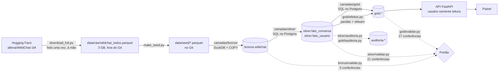

# Da Bronze à Gold: o que cada código faz, por que foi feito assim, limites e como validar

Este documento é para **ler o código e conferir os números**, camada por camada. Cada bloco tem a mesma estrutura:
**O que o código faz → Por que essa abordagem → Limitações → Como validar → Resultado da conferência de 14/11/2026.**

> Complementa [`COMO_FUNCIONA.md`](COMO_FUNCIONA.md) (que acompanha **uma pessoa** passo a passo) e [`VALIDACAO.md`](VALIDACAO.md)
> (consultas para conferir no DBeaver e no Power BI). Aqui o foco é a **lógica das transformações** e a **conciliação de ponta a ponta**.
> Conexão para as consultas: DBeaver em `localhost:5433`, banco `retencao`, usuário `auditor`, senha `auditor` (somente leitura).

## Sumário
1. [Mapa do fluxo e dos arquivos](#1-mapa-do-fluxo-e-dos-arquivos)
2. [Antes do ETL: a semente](#2-antes-do-etl-a-semente)
3. [O maestro: `main.py`, migrações e transação](#3-o-maestro-mainpy-migrações-e-transação)
4. [Camada Bronze](#4-camada-bronze)
5. [Camada Silver](#5-camada-silver)
6. [Camada Gold](#6-camada-gold)
7. [Efeitos (`gold/efeitos.py`, grava na Gold)](#7-efeitos-goldefeitospy-grava-na-gold)
8. [Auditoria e portão de qualidade](#8-auditoria-e-portão-de-qualidade)
9. [Validação de ponta a ponta (resultados de 14/11/2026)](#9-validação-de-ponta-a-ponta-resultados-de-14112026)
10. [Limitações e pontos de atenção, consolidados](#10-limitações-e-pontos-de-atenção-consolidados)
11. [Checklist para você validar](#11-checklist-para-você-validar)

---

## 1. Mapa do fluxo e dos arquivos



| Arquivo | Papel | Roda quando |
|---|---|---|
| `etl/semente/download_full.py` | baixa o WildChat-1M inteiro do Hugging Face | uma vez, à mão |
| `etl/semente/make_seed.py` | separa o bruto em 2 arquivos pequenos (a "semente") | uma vez, à mão |
| `etl/main.py` | a receita: prepara, constrói e valida cada camada, publica | todo `docker compose up` |
| `etl/comum/` (`banco.py`, `acesso.py`, `definicoes.py`, `qualidade.py`) | conexão e migrações, contas, regras de negócio, executor das conferências | usado por todas as camadas |
| `etl/camadas/bronze/` (`registrar_lotes`, `limpar`, `carregar`, `validar`) | Parquet → tabela `bronze.wildchat` e as 5 conferências dela | dentro do `main.py` |
| `etl/camadas/silver/` (`limpar`, `sql`, `construir`, `auditoria`, `validar`) | limpeza, "pessoa", visitas, retorno, elegibilidade, tema, recusa; linhagem; 21 conferências | dentro do `main.py` |
| `etl/camadas/gold/` (`limpar`, `sql`, `construir`, `efeitos`, `auditoria`, `validar`) | resumos que a tela lê, efeitos ajustados, 27 conferências | dentro do `main.py` |
| `analise/08_recalculo_independente.py` | recalcula a Silver por outro caminho (pandas) e compara | quando você quiser validar |

Cada pasta de camada tem um `LEIA-ME.md` curto, e `etl/LEIA-ME.md` mostra a receita inteira.

---

## 2. Antes do ETL: a semente

**O que os códigos fazem**
- **`download_full.py`:** usa a biblioteca `huggingface_hub` para listar os arquivos `.parquet` do repositório de dados `allenai/WildChat-1M` (`HfApi.list_repo_files`) e baixar um por vez (`hf_hub_download`). Pede token da conta. Cada arquivo é anexado a um Parquet único (`pyarrow.ParquetWriter`) e apagado em seguida, para não encher o disco. Resultado: `data/raw/wildchat_todos.parquet` (cerca de 3 GB, 837.989 conversas).
- **`make_seed.py`:** lê esse arquivo com o DuckDB e escreve **dois** arquivos Parquet (compressão zstd):
  - `wildchat_brasil.parquet`: o Brasil **completo**, com o texto das conversas (11.621 linhas, 22,2 MB);
  - `wildchat_outros_paises.parquet`: os demais países **só com metadados**, sem texto (826.368 linhas, 35,3 MB). O filtro é `country IS DISTINCT FROM 'Brazil'`, que inclui as 1.060 linhas com país vazio (nada é descartado em silêncio).
  - Nos dois acrescenta uma coluna calculada, `primeira_resposta_ts`: o horário da 2ª mensagem da conversa (a 1ª resposta do assistente).

**Por que essa abordagem:** o repositório precisa subir com um comando, sem baixar 3 GB (ADR-002). Separar o Brasil dos outros países permite entregar o texto só de onde a análise usa, e deixa o arquivo dos outros países 100% sem texto.

**Limitações**
- É uma **foto fixa** do WildChat; não há atualização automática.
- Só o Brasil tem texto, então tema, recusa e efeitos só existem para ele.
- **A bronze não é 100% "como veio":** a coluna `primeira_resposta_ts` é derivada na semente. Todo o resto é cópia fiel.
- O Brasil tem o texto das conversas dentro do repositório, que por isso deve ser privado.

**Como validar:** `SELECT arquivo, linhas, left(sha256,12) FROM ops.bronze_lote ORDER BY id DESC LIMIT 2;`
**Resultado:** `wildchat_brasil.parquet` 11.621 linhas (`e81720c4ad81…`) e `wildchat_outros_paises.parquet` 826.368 linhas (`77ee2c1525a1…`). A soma é 837.989.

---

## 3. O maestro: `main.py`, migrações e transação

**O que o código faz, em ordem**
1. **`banco.conectar`** (`etl/comum/banco.py`): tenta conectar ao banco até 30 vezes, esperando 1 segundo entre as tentativas.
2. **Abre duas conexões:**
   - `ops` (autocommit): cada comando vale na hora. Guarda o **histórico** (execução, lotes, conferências), que precisa sobreviver mesmo a uma carga que falhe.
   - `dw` (transação): o trabalho das três camadas, que só vale se tudo terminar bem.
3. **`banco.migrar`:** garante a tabela `public.schema_migrations` e aplica, em ordem alfabética, só os arquivos de `db/migrations/` que **ainda não estão nela**. Primeira subida: os 23 arquivos. Depois: nenhum (a menos que exista um novo).
4. **`acesso.garantir_conta_avaliacao`** (`etl/comum/acesso.py`): cria ou atualiza as contas de acesso do `.env`.
5. **`banco.abrir_execucao`:** `INSERT INTO ops.etl_execucao` com status `rodando`.
6. **A receita (`carga` em `main.py`), camada por camada.** Cada camada **limpa → constrói → valida**, e a validação roda logo depois da construção:
   | Camada | O que roda, em ordem |
   |---|---|
   | Bronze | `registrar_lotes` (sha256, linhas, `ops.bronze_lote`) → `limpar_bronze` (`TRUNCATE`) → `carregar` → `validar_bronze` (5 conferências) |
   | Silver | `construir_silver` (já começa com `limpar_silver`) → `auditar_silver` → `validar_silver` (21) |
   | Gold | `construir_gold` (já começa com `limpar_gold`) → `construir_efeitos` → `auditar_gold` → `validar_gold` (27) |
7. **Se alguma conferência falhar (modo estrito):** a carga **para naquela camada**, `ROLLBACK`, status `falhou`; nada é publicado. Se tudo passar: `COMMIT` e status `ok`.
**Por que essa abordagem**
- **Reconstruir tudo a cada carga** (em vez de somar ao que já existe) garante que a mesma semente sempre dá o mesmo resultado, e elimina a classe de erros de "dado antigo misturado com novo".
- **Uma só transação** significa que a API nunca vê um estado pela metade.
- **Migrações com lista de controle:** cada arquivo roda uma vez; um banco novo e um banco antigo chegam ao mesmo esquema.

**Limitações e pontos de atenção**
- O `TRUNCATE` pede um bloqueio exclusivo nas tabelas. Uma consulta que chegar **durante** a carga **fica esperando** até o `COMMIT` (cerca de 1,5 minuto), em vez de ver os dados antigos, como o comentário do código sugere. No fluxo normal (a API só sobe depois do ETL) isso não aparece. Só afeta rodar o ETL de novo com a API já no ar.
- As migrações **não são idempotentes sozinhas**: um `CREATE SCHEMA silver;` repetido dá erro. Quem evita isso é a lista `schema_migrations`.
- O comentário de abertura da migração `001` ("Bronze = Parquet … fora do banco") ficou **desatualizado**: desde a `005` a bronze é uma tabela do Postgres. Não editei o arquivo para não mexer numa migração já aplicada.

**Como validar:** `SELECT count(*) FROM public.schema_migrations;` e `SELECT id, status, linhas_lidas, linhas_carregadas FROM ops.etl_execucao ORDER BY id DESC LIMIT 3;`
**Resultado:** 23 migrações aplicadas; última carga com status `ok`.
Teste feito: um arquivo SQL com "criar tabela" seguido de divisão por zero **não deixou a tabela criada** (cada arquivo é atômico).

---

## 4. Camada Bronze

**Código:** [`etl/camadas/bronze/`](../etl/camadas/bronze/) (o arquivo principal é [`carregar.py`](../etl/camadas/bronze/carregar.py)) · **Tabela:** `bronze.wildchat`

**O que o código faz**
1. Coloca o fuso do DuckDB em UTC (`SET TimeZone='UTC'`) para os horários não mudarem na leitura.
2. Para cada um dos dois arquivos, monta um `SELECT` próprio (as colunas diferem: o Brasil tem `conversation` e as moderações; os outros países não).
3. O DuckDB lê o Parquet com `read_parquet(...)` e transforma os campos aninhados (`header`, `conversation`, `openai_moderation`, `detoxify_moderation`) em **texto JSON** com `to_json(...)`. Antes remove o caractere `\u0000`, que o `jsonb` do Postgres não aceita.
4. Grava o resultado num **CSV temporário** e o envia ao Postgres com `COPY ... FROM STDIN`, em pedaços de 1 MB.
5. Cada linha ganha `bronze_id` (ordem de carga; reinicia a cada carga) e `arquivo_origem`.
6. Conta as linhas por arquivo e devolve ao `main.py`.

**Por que essa abordagem**
- **DuckDB para ler Parquet:** é rápido, roda dentro do Python, sem servidor.
- **`COPY` em vez de `INSERT`:** é a forma rápida de carregar cerca de 840 mil linhas no Postgres (14 segundos).
- **Uma tabela só** para os dois arquivos, com `arquivo_origem` dizendo de onde veio cada linha. Isso simplifica a Silver (um `FROM` só).
- **`jsonb`** guarda as estruturas aninhadas sem perder nada e permite consultá-las em SQL.
- **Nada é limpo aqui:** a Bronze serve para você poder voltar ao dado de origem e comparar com a Silver.

**Limitações**
- Duplicatas e valores vazios continuam (as 17 cópias exatas e as 1.060 linhas sem país estão aqui).
- Contém o **texto** das conversas do Brasil; por isso só o ETL a enxerga (o usuário `api_ro` não tem privilégio nenhum na Bronze).
- Depende do formato dos Parquet da semente; se a semente mudar de colunas, o `carregar.py` precisa mudar junto.

**Como validar**
```sql
SELECT arquivo_origem, count(*) FROM bronze.wildchat GROUP BY 1;                         -- 11.621 e 826.368
SELECT count(*) FROM bronze.wildchat WHERE conversation IS NOT NULL
  AND jsonb_array_length(conversation) <> turn * 2;                                      -- 0
SELECT bronze_id, model, country, header->>'user-agent' AS ua, "timestamp", primeira_resposta_ts,
       left(conversation->0->>'content', 80) AS pedido
FROM bronze.wildchat WHERE country = 'Brazil' LIMIT 5;                                   -- olhe os dados crus
```
**Resultado:** 837.989 linhas = 11.621 + 826.368; nenhuma conversa com número de mensagens diferente de 2 × turnos.

---

## 5. Camada Silver

**Código:** [`etl/camadas/silver/`](../etl/camadas/silver/) (comandos em [`sql.py`](../etl/camadas/silver/sql.py), ordem em [`construir.py`](../etl/camadas/silver/construir.py)) e [`etl/comum/definicoes.py`](../etl/comum/definicoes.py) · **Tabelas:** `silver.fato_conversa`, `silver.fato_usuario`, `silver.dim_pais`, `silver.dim_tema`
Todo o trabalho é SQL **dentro do Postgres**; o Python só envia os comandos. Os passos criam tabelas temporárias (`bruto`, `conv0`, `conv`, `usuarios`) que somem no fim da transação.

### 5.1 `bruto`: achatar a Bronze (nenhuma linha sai)
- Tira de dentro do JSON: o navegador (`header->>'user-agent'`), o idioma do navegador (1ª tag de `accept-language`, em minúsculas), o **pedido** (`conversation->0->>'content'`) e a **resposta** (`conversation->1->>'content'`).
- País vazio vira `'Desconhecido'`.
- **Início** = `primeira_resposta_ts`; **fim** = `timestamp` (último turno).
- *Por quê:* as mensagens da pessoa não têm horário na base; só as do assistente. É a melhor aproximação disponível (BDR-001).
- *Limite:* o início real da conversa é um pouco antes da 1ª resposta.

### 5.2 `conv0`: limpar
- Descarta linhas **sem horário de início ou sem endereço de internet** (hoje, nenhuma).
- Remove **cópias exatas**: mesmo `conversation_hash` + `hashed_ip` + início (`DISTINCT ON`), com desempate fixo para o resultado ser sempre o mesmo.
- *Por quê:* só a cópia **exata** é duplicata. O mesmo texto com endereço ou horário diferentes é **outra conversa** (outra pessoa pode ter digitado o mesmo pedido); isso afeta 13.201 linhas, que ficam.
- *Resultado:* 837.989 → 837.972 (17 removidas).

### 5.3 `dim_tema` e `dim_pais`
- `dim_tema`: os 11 temas. `dim_pais`: um registro por país, com nome, **fuso**, se o fuso é aproximado, idioma padrão, se tem texto (só o Brasil) e o código ISO.
- *Fuso:* o dicionário `PAISES_META` mapeia cerca de 40 países; os demais ficam `UTC` e "aproximado". Países com vários fusos (Brasil, EUA, Rússia, Canadá, Austrália, México, Indonésia, Portugal) também ficam marcados como aproximados.
- *Limite:* um único fuso por país muda a hora e o dia da semana de quem mora em outro fuso.

### 5.4 `conv`: derivar por conversa
- **Navegador e sistema sem versão** (`UA_NORM_SQL`): as regras são testadas **na ordem**, e a ordem importa. Edge (`Edg/`) e Opera (`OPR/`) antes do Chrome, porque também contêm "Chrome"; Chrome antes do Safari, pelo mesmo motivo; Android antes de Linux; iPhone/iPad antes de Mac.
  *Por quê:* quando o navegador atualiza de versão, a mesma pessoa não pode virar outra. Foi o incidente da seção 4.2 do desafio.
- **Código da pessoa:** `usuario_id = primeiros 12 caracteres de md5(endereço_embaralhado + '|' + navegador/sistema)`. Para agrupar o código usa a chave **inteira** (`uk`), não só os 12 caracteres.
  *Por quê:* não há login. Esse é o melhor identificador disponível. 12 caracteres hexadecimais bastam para 200 mil pessoas (chance de colisão da ordem de 0,007%).
  *Limite (o maior da análise):* quem troca de rede ou aparelho vira outra pessoa, e quem divide rede vira uma só. `docs/SENSIBILIDADE.md` mede o efeito: só o intervalo de 30 minutos entre visitas move o retorno de 19,6% a 26,3%.
- **Duração e tamanhos:** `duracao_s`, `prompt1_chars`, `resp1_chars` (tamanhos só no Brasil).
- **Recusa (só Brasil), `RECUSA_SQL`:** olha os **300 primeiros caracteres** da 1ª resposta, em minúsculas, e procura expressões como "desculp", "sinto muito", "lamento", "não posso", "i'm sorry", "i cannot", "as an ai".
  *Por quê:* uma regra de palavras é barata, repetível e auditável; não depende de um modelo de linguagem externo.
  *Limite:* erra para os dois lados (por exemplo, "desculpe a demora" conta como recusa) e **a precisão ainda não foi medida em amostra manual**.
- **Tema (só Brasil), `TEMA_SQL`:** testa o **1º pedido** contra uma lista de regras **na ordem; a primeira que bate vence** (1 Vazio, 2 Saudação, 3 Prompt de imagem, 4 Persona/roleplay, 5 Adulto/sensível, 6 Tecnologia/código, 7 Tarefa escolar, 8 Escrita/edição/tradução, 9 Ficção, 10 Conhecimento/pergunta, 11 Outro).
  *Limite:* a ordem decide. Um pedido que contém "como" e "python" vira Tecnologia, porque a regra 6 vem antes da 10. É uma escolha de projeto, não uma verdade; também sem precisão medida.

### 5.5 `usuarios`: visitas, retorno e elegibilidade (a regra central)
Por pessoa (país + chave), com as conversas em ordem de horário:
- **Visita:** uma nova visita começa na 1ª conversa ou quando passam **mais de 30 minutos** entre o fim da conversa anterior e o início desta (`GAP_SESSAO_MIN = 30`).
- **Voltou em 7 dias (`voltou_7d`):** existe conversa numa visita 2 ou mais, com início **até 7 dias** depois do início da 1ª conversa (`JANELA_RETORNO_DIAS = 7`). `voltou_24h` é o mesmo com 1 dia. `dias_ate_voltar` é a distância até a 2ª visita.
- **1ª experiência:** modelo, idioma, turnos, navegador, sistema, estado, tamanhos, recusa e tema vêm **da primeira conversa**.
- **Quando, no fuso do país:** `semana` (segunda-feira local), `hora` (0 a 23) e `dia_semana` (1 = segunda).
- **Elegível:** a 1ª conversa está entre **a primeira data do país + 30 dias** (`LAVAGEM_DIAS`) e **a última data − 7 dias**. No Brasil, de 09/05/2023 a 22/04/2024. `janela_30d` é igual, com −30 dias no fim.
- *Por quê:* os +30 dias evitam contar usuário antigo como novo (a base só começa em 09/04/2023). Os −7 dias evitam contar como "não voltou" quem não teve tempo de voltar. Os 30 minutos seguem a convenção de análise web.
- *Limites:* a janela de 7 dias é uma escolha de negócio (a curva mostra que 91,7% de quem volta em até 30 dias já voltou nos primeiros 7). O retorno é medido **a partir do início** da 1ª conversa.

### 5.6 Gravação
`INSERT … SELECT` de `conv` em `silver.fato_conversa` (guarda `bronze_id`, que liga cada conversa à sua linha na Bronze) e de `usuarios` em `silver.fato_usuario`.
**Não guarda:** texto das conversas, nem o endereço de internet.

**Como validar**
```sql
SELECT count(*) FROM silver.fato_conversa;                                  -- 837.972
SELECT count(*) FROM silver.fato_usuario;                                   -- 197.319
SELECT (SELECT sum(convs_total) FROM silver.fato_usuario) - (SELECT count(*) FROM silver.fato_conversa);   -- 0
SELECT * FROM auditoria.audite_usuario('1cb966329f48');                     -- passo a passo de uma pessoa
```
Mais importante: **rode o recálculo independente** (seção 9), que refaz a Silver em outro código e compara pessoa por pessoa.

---

## 6. Camada Gold

**Código:** [`etl/camadas/gold/`](../etl/camadas/gold/) (comandos em [`sql.py`](../etl/camadas/gold/sql.py)). Tudo em SQL, lendo só a Silver. É a **única** camada que a API enxerga.
**Regra comum:** taxa e margem de erro (intervalo de Wilson, 95%) só aparecem com **30 ou mais pessoas** (`AMOSTRA_MINIMA`); abaixo disso ficam `NULL` e a tela avisa.
**Onde a taxa e a margem de erro são calculadas:** só `agg_retorno_semana` e `agg_retorno_fator` guardam a taxa e o intervalo já prontos. As demais tabelas (por exemplo `agg_recusa_modelo`, `agg_estrato`, `agg_curva_retorno`, `agg_concentracao`) guardam **só contagens**; a taxa e o intervalo de Wilson (com a mesma regra de 30 pessoas) são calculados **na API** (`backend/app/main.py`, função `_com_taxa`, que usa as mesmas funções SQL `gold.wilson_lo/hi`). A tela só formata.

**Por que Wilson:** é estável com poucas pessoas e com taxas perto de 0% ou 100%, onde a aproximação normal falha. Está em `gold.wilson_lo` e `gold.wilson_hi` (migração 001).
**Limite geral:** Wilson supõe que cada pessoa é independente; como a "pessoa" é aproximada, as margens de erro podem ser otimistas.

| Tabela (linhas) | Granularidade | Regra | Por quê / limite |
|---|---|---|---|
| `gold.pais` (um por país) | país | pessoas, elegíveis, conversas, 1ª e última data, turnos médios e mediana, % GPT-4; depois também top 10 mais ativas, `voltaram_7d`, `voltaram_24h`, `elegiveis_sem_top10`, `voltaram_sem_top10` | alimenta o seletor de país e os cartões |
| `agg_retorno_semana` (6.359) | país × semana de chegada | `novos` (todas as pessoas), `elegiveis`, `voltaram_7d`, taxa e Wilson | `novos` inclui não elegíveis; a semana é a local da 1ª conversa |
| `agg_retorno_fator` (6.751) | país × fator × nível | retorno por **13 fatores** (modelo, idioma, período do dia, dia da semana, turnos, tema, recusa, tamanho do pedido e da resposta, sistema, navegador, dispositivo, idioma × navegador) | os níveis (faixas) estão fixos em SQL (`_FATORES_VALUES`); são escolhas legíveis, não estatísticas |
| `agg_retorno_mes_fator` (12.768) | país × mês × fator × nível | só 4 fatores (modelo, turnos, período do dia, tema); só elegíveis | base da decomposição "chegou gente diferente × a mesma gente voltou diferente" |
| `agg_uso_dia` (30.953) | país × dia local | conversas e pessoas distintas | uso diário (hoje sem tela própria) |
| `agg_curva_retorno` (2.366) | país × 14 pontos (0 a 30 dias) | de quem tem `janela_30d`, quantos voltaram até `d` dias | base de 30 dias completos, por isso o 7 dias da curva (24,0%) difere do 23,7% da Visão geral |
| `agg_estrato` (8) | família de modelo × fator | saudação e recusa **dentro** de GPT-4 e de GPT-3.5 | só Brasil; diferença simples, sem ajuste |
| `agg_recusa_modelo` (920) | país × versão do modelo | conversas, com recusa, tamanho médio da resposta, elegíveis, voltaram | recusa só onde há texto |
| `agg_concentracao` (655) + colunas em `gold.pais` | país × faixa (1, 2-3, 4-10, 11+) | pessoas e conversas por faixa; % das 10 mais ativas e retorno com e sem elas | mostra se poucas pessoas dominam o uso |
| `agg_uso_hora` (18.389) | país × dia da semana × hora | conversas no fuso do país | mapa de calor de horários |
| `agg_modelo_mes` (1.917) | país × mês | conversas e conversas em GPT-4 | GPT-4 ao longo do tempo |
| `problema_qualidade` (11) | problema | quantas conversas cada problema afeta | tela Ajuda |
| `catalogo_indicador` (12) | indicador | definição, fórmula, SQL de referência, fonte | botão "i" |
| `efeito_fator` (16) | contraste | ver seção 7 | achados |

**Como validar** (cada soma da Gold tem de bater com a Silver)
```sql
SELECT sum(novos), sum(elegiveis), sum(voltaram_7d) FROM gold.agg_retorno_semana;   -- 197.319 · 174.629 · 37.540
SELECT count(*), count(*) FILTER (WHERE elegivel), count(*) FILTER (WHERE elegivel AND voltou_7d) FROM silver.fato_usuario;
SELECT sum(conversas) FROM gold.agg_uso_dia;                                         -- 837.972
SELECT sum(usuarios) FROM gold.agg_curva_retorno WHERE dias = 30;                    -- 164.829
SELECT count(*) FILTER (WHERE janela_30d) FROM silver.fato_usuario;                  -- 164.829
```

---

## 7. Efeitos (`gold/efeitos.py`, grava na Gold)

**Código:** [`etl/camadas/gold/efeitos.py`](../etl/camadas/gold/efeitos.py) · **Tabela:** `gold.efeito_fator` (16 linhas, só Brasil)

**O que o código faz**
1. Lê as pessoas **elegíveis** do Brasil (2.234), **ordenadas por `usuario_id`** (para o resultado não mudar de uma carga para outra).
2. Para cada contraste (por exemplo, "com recusa em vez de sem"), define quem **tem o fator** (tratados) e quem **não tem** (controle). Se algum dos dois grupos tiver menos de 30 pessoas, não estima.
3. Ajusta por características **anteriores** ao fator (mês, período do dia, fim de semana, sistema, navegador, estado, e conforme o caso modelo, tema, tamanho do pedido, idioma).
4. Calcula o efeito com o estimador **AIPW** (duplamente robusto) e **validação cruzada em 5 partes**: uma regressão logística estima a chance de ter o fator, outras duas estimam a chance de voltar com e sem o fator, e o efeito é a média das correções (`psi`). A chance de ter o fator é limitada a [2,5%; 97,5%] para evitar pesos extremos. O erro-padrão vem do desvio da própria média de `psi`.
5. Guarda também o **efeito bruto** (diferença simples de taxas), a **sobreposição** entre os grupos, e o **E-value** (o quanto um fator não medido teria de pesar para anular o resultado).

**Por que essa abordagem:** comparar grupos "parecidos" tira parte do efeito de quem já chega mais interessado. O AIPW funciona se **qualquer um** dos dois modelos (de tratamento ou de desfecho) estiver bem ajustado. A validação cruzada evita ajustar demais. É o método padrão para "associação ajustada" quando não dá para fazer um experimento.

**Limitações**
- **Não prova causa.** Existem fatores não medidos (o principal: engajamento prévio). O E-value de 1,4 a 1,6 nos efeitos principais diz que um confundidor moderado anularia os resultados.
- **Múltiplos testes:** são 16 contrastes. Com a correção de Bonferroni (p < 0,003), só **turnos** e **pedido longo** resistem; **saudação** e **recusa** são indícios (BDR-004).
- O intervalo **não inclui** o ruído da divisão em partes (cerca de ±1 pp, medido em `docs/SENSIBILIDADE.md`).
- **Turnos** e **tamanho do pedido** são sinais de perfil, não alavancas (a pessoa já os traz quando chega).
- Tema e recusa herdam o erro das regras de palavras.
- Só o Brasil.

**Como validar**
```sql
-- o efeito bruto tem de ser a diferença simples de taxas na Silver
SELECT efeito_bruto_pp FROM gold.efeito_fator WHERE contraste LIKE 'Com recusa%';        -- -8,85
WITH r AS (SELECT recusa, count(*) n, count(*) FILTER (WHERE voltou_7d) v
           FROM silver.fato_usuario WHERE pais='Brazil' AND elegivel GROUP BY 1)
SELECT round(((SELECT 100.0*v/n FROM r WHERE recusa) - (SELECT 100.0*v/n FROM r WHERE NOT recusa))::numeric, 2);   -- -8,85
```
**Resultado:** recusa −8,85 pp nos dois lados; saudação × conhecimento −10,85 pp nos dois lados.

---

## 8. Auditoria e portão de qualidade

**`silver/auditoria.py` e `gold/auditoria.py`** gravam, a cada carga, em `auditoria.*` (a da silver logo depois de construir a silver; a da gold completa o funil por país com os números da gold): linhas por camada, **cada linha excluída com o motivo** (`registro_excluido`), valores vazios antes e depois, exemplos "antes e depois" e o funil por país. Não guarda texto nem endereço.

As **64 conferências** (2 de integridade, feitas antes de reconstruir; veja `docs/PREVENCAO_DE_DIVERGENCIAS.md`) ficam em cada camada (`bronze/validar.py` 5, `silver/validar.py` 27 contando o recálculo independente, `gold/validar.py` 27, mais 1 de deriva por camada) e rodam **logo depois de cada camada ser construída**, dentro da transação; `comum/qualidade.py` só executa e grava. Se uma falhar, a carga para ali e desfaz tudo (não espera as camadas seguintes). Seis grupos:

| Grupo | O que protege | Exemplo |
|---|---|---|
| `bronze_arquivos` | o que entrou bate com os arquivos | linhas da Bronze = soma dos lotes; JSON com 2 × turnos mensagens |
| `bronze_silver` | nada some sem registro | Bronze = Silver + excluídas; toda conversa aponta para uma linha da Bronze |
| `silver_interna` | a Silver é coerente | soma de `convs_total` = conversas; nenhum `usuario_id` em dois países; **recálculo do retorno, da elegibilidade e da 1ª vez** |
| `silver_gold` | a tela mostra o que a Silver tem | somas por semana, país, fator, curva, uso diário, concentração |
| `efeitos` | os efeitos são coerentes | o intervalo contém a estimativa; nenhum grupo com menos de 30 |
| `validados` | os números principais não mudaram sem aviso | 911 conversas com recusa, 230 pessoas com recusa na 1ª conversa, 56 conversas redigidas, os 11 temas |

**Por que essa abordagem:** as conferências são **leis de conservação** (a soma de baixo tem de dar a de cima) mais **números validados à mão**. Se uma regra mudar sem ninguém perceber, a carga falha.

**Limitações**
- O "recálculo independente" de `silver/validar.py` é independente **na lógica das visitas**, mas parte de `silver.fato_conversa`: não testa a derivação do `usuario_id`, do navegador e do início, que acontece **antes**. Por isso criei o `analise/08_recalculo_independente.py`, que parte dos **arquivos da semente**.
- Os "números validados" são valores escritos no código. Se uma definição mudar de propósito, é preciso atualizá-los, e só deve-se fazer isso depois de conferir à mão (`docs/VALIDACAO.md`).
- As conferências garantem **coerência**, não **verdade**: não dizem se a definição de "pessoa" é boa.

---

## 9. Validação de ponta a ponta (resultados de 14/11/2026)

### 9.1 Conciliação entre camadas (consultas direto no banco)
| # | Conferência | Esperado | Obtido |
|---|---|---|---|
| 1 | Soma das linhas dos 2 arquivos (`ops.bronze_lote`) | 837.989 | 837.989 |
| 2 | Linhas de `bronze.wildchat` | 837.989 | 837.989 |
| 3 | Brasil (arquivo do Brasil) | 11.621 | 11.621 |
| 4 | Arquivo dos outros países | 826.368 | 826.368 |
| 5 | `silver.fato_conversa` | 837.972 | 837.972 |
| 6 | Excluídas (`auditoria.registro_excluido`) | 17 | 17 |
| 7 | Bronze − Silver − excluídas | 0 | **0** |
| 8 | `silver.fato_usuario` (pessoas) | 197.319 | 197.319 |
| 9 | Soma de `convs_total` − conversas | 0 | **0** |
| 10 | `gold.pais`: soma de pessoas | 197.319 | 197.319 |
| 11 | `gold.pais`: soma de conversas | 837.972 | 837.972 |
| 12 | Gold semanal: soma de `novos` | 197.319 | 197.319 |
| 13 | Gold semanal: soma de `elegiveis` | 174.629 | 174.629 |
| 14 | Gold semanal: soma de `voltaram_7d` | 37.540 | 37.540 |
| 15–16 | Silver: elegíveis · elegíveis que voltaram | 174.629 · 37.540 | 174.629 · 37.540 |
| 17 | Gold uso diário: conversas | 837.972 | 837.972 |
| 18–19 | Gold curva (30 dias) · Silver `janela_30d` | iguais | 164.829 · 164.829 |
| 20 | Gold fator modelo: elegíveis | 174.629 | 174.629 |
| 21–22 | Gold `modelo_mes` · `uso_hora`: conversas | 837.972 | 837.972 |
| 23–25 | Conferências da última carga | todas · status `ok` | 62 de 62 · `ok` (na hora da conferência eram 53; depois entraram o recálculo independente e a deriva) |

### 9.2 Recálculo independente (`analise/08_recalculo_independente.py`)
O script lê **os arquivos da semente**, reimplementa as regras em Python/pandas (sem usar nenhum SQL do pipeline) e compara com a Silver **pessoa por pessoa**.

| O que | Python | Silver |
|---|---|---|
| Conversas lidas · excluídas | 837.989 · 17 | 837.989 · 17 |
| Pessoas | 197.319 | 197.319 |
| Elegíveis | 174.629 | 174.629 |
| Elegíveis que voltaram | 37.540 | 37.540 |
| Brasil: pessoas · elegíveis · voltaram · taxa | 2.530 · 2.234 · 530 · 23,72% | 2.530 · 2.234 · 530 · 23,7% |
| Brasil: voltaram em 24 h | 356 | 356 |
| Semana de 13/11/2023 (Brasil): novos · elegíveis · voltaram | 55 · 55 · 16 | 55 · 55 · 16 |
| **Divergências pessoa a pessoa** em `voltou_7d`, `voltou_24h`, `elegivel`, `primeira_vez`, `convs_total` | — | **0 em 197.319 pessoas** |
| Pessoas só em um dos lados | 0 | 0 |

### 9.3 Conferências estatísticas
- **Wilson:** recalculei à mão 530/2.234 → 23,72% [22,01%; 25,53%] e 198/2.234 → 8,86% [7,75%; 10,11%]. A Visão geral mostra 22,0% a 25,5% e 7,8% a 10,1%, iguais. (O cartão de 24 horas não mostra margem de erro; em Coortes, 326/2.039 tem outra base.)
- **Efeito bruto:** bate com a diferença simples de taxas na Silver (seção 7).

### 9.4 O que a validação **não** cobre
- Se a definição de "pessoa" é uma boa aproximação da realidade (só a análise de sensibilidade mede isso).
- A **precisão** das regras de tema e recusa (depende da conferência manual das amostras `exports/amostra_validacao_*.csv`).
- Os números da camada de **API e tela**: o próprio painel mostra os mesmos valores da Gold (por exemplo, 23,7% e "530 de 2.234"), e isso é conferido por teste automático (`backend/tests/test_api_x_gold.py`; relatório visual em `exports/fluxo_dos_dados.html`).

---

## 10. Limitações e pontos de atenção, consolidados
1. **"Pessoa" é aproximada** (endereço + navegador/sistema). É a premissa que mais pesa. Medida em `docs/SENSIBILIDADE.md`.
2. **Início = 1ª resposta do assistente**, não a mensagem da pessoa.
3. **Fuso único por país**; 40 países mapeados, o resto em UTC.
4. **Tema e recusa por regras de palavras:** precisão ainda não medida; a ordem das regras decide o tema.
5. **Só o Brasil tem texto**, então tema, recusa e efeitos só existem para ele.
6. **Janela de 7 dias, 30 minutos de visita e 30 dias de lavagem** são escolhas de negócio (BDR-001), não verdades.
7. **A bronze tem uma coluna derivada** (`primeira_resposta_ts`), criada na semente.
8. **`TRUNCATE` bloqueia leitores** durante a carga (e o comentário do código sugere o contrário).
9. **Comentário desatualizado** na migração `001` ("Bronze … fora do banco").
10. **Wilson supõe independência** entre pessoas; com a pessoa aproximada, as margens de erro podem ser otimistas.
11. **Efeitos são associação, não causa**; só 2 dos 16 resistem à correção para múltiplos testes; o intervalo não inclui o ruído da validação cruzada.
12. **Os "números validados" do portão** estão escritos no código e precisam ser atualizados (depois de conferir à mão) se uma definição mudar.
13. **A semente é uma foto fixa** do WildChat.

## 11. Checklist para você validar
Marque conforme for conferindo.

- [ ] Rodei as consultas da seção 9.1 no DBeaver e os números batem.
- [ ] Rodei `analise/08_recalculo_independente.py` e vi **0 divergências**.
- [ ] Li `camadas/bronze/carregar.py` e entendi o caminho Parquet → DuckDB → CSV → `COPY`.
- [ ] Li `camadas/silver/sql.py` e `comum/definicoes.py` e concordo com: 30 minutos, 7 dias, 30 dias de lavagem, início = 1ª resposta.
- [ ] Auditei uma pessoa com `SELECT * FROM auditoria.audite_usuario('1cb966329f48');` e conferi as conversas dela na Bronze.
- [ ] Conferi a semana de 13/11/2023 (55 / 55 / 16 / 29,1%) contra as pessoas da Silver.
- [ ] Li `camadas/gold/sql.py` e conferi que cada tabela agrega o que diz.
- [ ] Li `camadas/gold/efeitos.py` e `docs/bdr/BDR-004-analise-de-efeitos.md` e entendi por que só 2 efeitos resistem à correção.
- [ ] Conferi as amostras manuais de tema e recusa (`exports/amostra_validacao_*.csv`) e registrei a precisão.
- [ ] Decidi o que fazer com cada ponto da seção 10 (corrigir, aceitar ou documentar).
