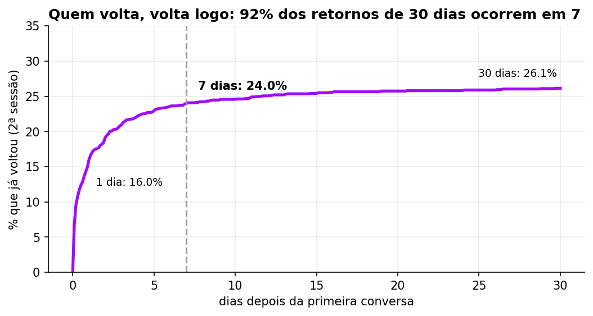
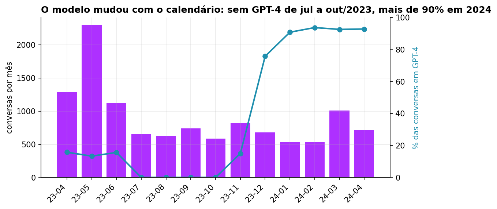

# O que faz quem experimentou o assistente voltar em até 7 dias? Achados e decisões

Desafio técnico Acaso · base WildChat-1M, conversas com `country = 'Brazil'` · período 08/04/2023 a 29/04/2024.
Os detalhes ficam nos ADRs e BDRs (`docs/`); este documento é o resumo.

## 1. Resposta em poucas linhas
De 2.530 pessoas que experimentaram o assistente no Brasil, **23,7% voltam em até 7 dias** (IC 95%: 22,0% a 25,5%; 2.234 elegíveis). O que mais se associa a voltar
é **como a pessoa abre a conversa**: quem começa só com uma saudação volta cerca de 8 a 12 pontos percentuais (pp) menos (nos dois modelos), e quem recebe uma recusa na primeira resposta, cerca de 10 pp
menos (sobretudo no GPT-4). **Trocar de modelo ou alongar a resposta não mostra ganho.** Isto é **associação ajustada**, não prova de causa: só um teste A/B separa causa de seleção.

## 2. Como medi (definições e premissas)
- **Pessoa:** não há ID de usuário; uso IP (anonimizado) + família do navegador e sistema, sem versão. **Sessão:** conversas com menos de 30 min entre uma e outra.
  **Retorno:** nova sessão em até 7 dias depois da 1ª conversa. **Elegível:** 1ª vez 30 dias depois do início dos dados e 7 dias antes do fim (evita "novos" falsos e janelas abertas).
  **Início da conversa:** a 1ª resposta do assistente (as falas do usuário não têm horário). **Dia e semana:** fuso de São Paulo.
- **Cada premissa tem um custo medido** (`docs/SENSIBILIDADE.md`): o **gap da sessão é a que mais pesa** (15 min: 26,3%; 60 min: 21,3%; 120 min: 19,6%); janela de 3 ou 14 dias dá 20,8% ou 25,3%;
  o user-agent completo (com a versão) infla para 26,2%; já a lavagem, o início da conversa e retirar os 10 usuários mais ativos mexem menos de 1,2 pp. **O 23,7% deve ser lido como "retorno com sessões de 30 min".**
- **Problemas de qualidade** (11 tratados, na tela "Ajuda"): 1.060 conversas sem país (mantidas como "Desconhecido"), 17 cópias exatas (excluídas), 13.201 com hash repetido em linhas
  diferentes (mantidas: são conversas distintas), 24.192 sem navegador, 163.178 sem estado, e 826.368 sem texto fora do Brasil.

## 3. O que os dados mostram (exploração)
Sete conclusões, cada uma com figura, intervalo e o que fazer, em [`docs/EDA.md`](EDA.md). As principais:
- **Quem volta, volta logo.** 16,0% voltam em 1 dia, 24,0% em 7 e 26,1% em 30: **92% dos retornos de 30 dias já ocorrem em 7**, e metade em cerca de 14 horas. A janela de 7 dias é adequada.

  
- **O modelo muda com o calendário.** GPT-4 é 13 a 16% das conversas em abr a jun/2023, **zero de jul a out** e mais de 90% em 2024; e o "GPT-3.5" tem versões muito diferentes (recusa de 2,5% a 13,1%). "GPT-4 contra GPT-3.5" mistura modelo com época.

  
- **O uso é raso e concentrado.** 56% das conversas têm 1 turno e 60% das pessoas têm uma só conversa; o retorno vai de 20,2% (1 turno) a **43,0% (7 ou mais)**. **20 pessoas (0,8%) fazem 39% das conversas:** volume não é gente, e retirá-las mexe só 0,3 pp no retorno.
- **Quando e onde.** O expediente (seg a sex, 9h às 18h) concentra 35,5% das conversas, acima dos 26,8% esperados se o uso fosse uniforme; a madrugada tem 20,1% (esperado 33,3%) e o fim de semana 29,0% (esperado 28,6%): o uso é diurno e do começo da noite. Mobile e desktop voltam igual (24,0% e 23,6%); o ecossistema Apple volta menos, mas **pode ser efeito da medida** (IP e navegador), e não agimos sobre isso.
- **Idioma:** 75,7% das conversas em português e 16,1% em inglês; quem escreve em um terceiro idioma, com o navegador em português, volta menos (hipótese a verificar, a detecção de idioma erra).
## 4. Os três achados e a decisão de cada um
Efeito ajustado (AIPW, comparando pessoas parecidas), em pp de retorno, IC 95%, ordenado pelo tamanho:

| Fator | Efeito [IC 95%] | Resiste à correção de 16 testes? |
|---|---|---|
| Recusa na 1ª resposta (com x sem) | **−9,6 [−17,3; −1,9]** | não (indício) |
| Saudação x pergunta de conhecimento | **−8,1 [−14,3; −1,8]** | não (indício) |
| Turnos (2 ou mais x 1) | +8,7 [+3,3; +14,1] | sim (perfil) |
| Pedido longo x curto | +6,3 [+2,2; +10,5] | sim (perfil) |
| Modelo (GPT-4 x GPT-3.5) | −0,6 [−5,0; +3,9] | sem efeito detectável |
| Resposta longa x curta | +0,1 [−5,3; +5,5] | sem efeito detectável |

1. **A saudação afasta (o achado mais firme).** 17% das pessoas abrem com "oi" e voltam ~8 pp menos (ajustado); dentro de cada modelo, −10,1 pp no GPT-3.5 e −11,9 pp no GPT-4, ambos com intervalo sem zero. **Decisão:** responder à saudação com exemplos do que o assistente faz (onboarding dentro da conversa) e **testar por A/B**.
2. **A recusa na primeira resposta afasta, sobretudo no GPT-4.** ~10 pp a menos em média, mas **−14,1 pp no GPT-4 e só −4,7 pp no GPT-3.5** (intervalo inclui zero): é um indício que depende do modelo. **Decisão:** auditar recusas e desculpas, **começando pelo GPT-4**, reduzir as falsas e testar respostas alternativas.
3. **Modelo maior ou resposta mais longa não trazem retorno.** **Decisão:** não justificar o custo do GPT-4 por retenção; usar turnos e pedido longo como **sinal precoce** de engajamento, não como alavanca (são comportamento de quem já está engajado).

**Por que mudou o retorno (mix ou taxa):** o painel compara, por padrão, o primeiro e o último mês com amostra boa (150 elegíveis ou mais): de mai./2023 (282 elegíveis) a abr./2024 (185), o retorno foi de 22,3% para 21,1% (−1,3 pp). Pelo tema do primeiro pedido, o perfil de quem chegou mudou um pouco (mix +2,2 pp), o retorno dentro dos perfis caiu (taxa −2,0 pp) e os dois se combinam (interação −1,5 pp); as três parcelas somam exatamente os −1,3 pp. Com 282 e 185 pessoas, nenhuma dessas parcelas é distinguível do ruído: **o retorno ficou praticamente estável**, o mesmo que diz a frase de tendência da Visão geral (1ª metade contra 2ª metade dos meses, sem diferença detectável).
Escolhi esse par, e não o de maior variação, porque o par de maior variação entre 11 candidatos puxa o resultado para o ruído: por exemplo, de set. a out./2023 o retorno foi de 31,2% para 20,3% (−10,9 pp), mas com 125 e 138 pessoas isso é em boa parte acaso. O painel deixa escolher qualquer outro par de meses, com o aviso de amostra pequena.
Uso mês e não semana porque uma semana tem só 40 a 90 elegíveis; o mês tem de 87 a 295 elegíveis, então ainda há ruído (o painel avisa).

**O que a análise prova e o que não prova.** Prova associação ajustada por calendário, dispositivo, região, tema, pedido, idioma e modelo. **Não prova causa:** o engajamento prévio da pessoa não é medido (o E-value de 1,4 a 1,6 mostra que um confundidor moderado anularia os efeitos).
**Ressalva:** tema e recusa vêm de regras de palavras e **ainda dependem da conferência manual** da amostra (`exports/`), de que os achados 1 e 2 dependem.
**O que os dados não permitem medir e o que falta:** avaliação da resposta pela própria pessoa, custo e latência, identidade estável e o motivo de não voltar.

## 5. Sugestões (saíram dos dados; detalhe em `docs/EDA.md`)
- **Para o assistente:** (1) **onboarding na saudação**, o achado mais firme, testado por A/B; (2) revisar recusas, **começando pelo GPT-4**; (3) cuidar de quem escreve em outros idiomas; (4) pensar o reengajamento **no primeiro dia**, já que metade de quem volta o faz em cerca de 14 horas.
- **Para o dashboard (indicadores e telas pensados depois de olhar os dados; os itens 1 a 6 já estão implementados, nas telas Visão geral, Coortes e O que faz voltar):** (1) **"voltou em 24 horas"** e a curva de retorno; (2) **pessoas ativas** no lugar de conversas, com **alerta de uso concentrado ou automatizado**; (3) tela **"Quando usam"** (hora × dia no fuso do país);
  (4) tela **"Dispositivo e navegador"**, com o aviso de que a medida pode distorcer; (5) **recusa por versão do modelo**; (6) **idioma do pedido × idioma do navegador**; (7) a **avaliação da resposta pelo usuário**, o dado que falta. Além do **mix × taxa** a cada mudança de retorno, que já está no painel.
## 6. O dashboard e a arquitetura
Quatro telas para pessoas de negócio, cada uma com a pergunta que responde, cada número com definição e fórmula (botão "i") e cada efeito com intervalo: Visão geral, O que faz voltar (com recortes exploratórios de dispositivo e idioma, rotulados como hipótese), Coortes e Ajuda.
Há seletor de país (202), idioma PT/EN, tema claro e escuro e comparação de todos os países com 30 ou mais elegíveis, em lista fixa, e a média geral (Brasil 23,7% contra 21,5%).
**O painel mostra:** contagens e taxas agregadas, com intervalo, e efeitos. **Nunca mostra:** texto das conversas, IP (nem com hash), user-agent nem identificador de usuário. Não mostra a taxa de grupos com menos de 30 pessoas por um motivo estatístico, não de privacidade: com tão poucas pessoas a taxa varia demais para ser confiável.
**Fluxo:** semente do bruto → ETL (bronze, silver e gold no Postgres, numa só transação) → API somente leitura (lê só a gold) → Next.js. Sobe com `docker compose up --build` (diagrama, endpoints e telas no `README.md`; implantação na AWS em `infra/README.md`).
**AWS:** CloudFront e ALB na frente de duas tarefas ECS Fargate (API e front), ETL diário como tarefa agendada, RDS PostgreSQL na base analítica, S3 para o bruto e Secrets Manager; região de São Paulo (LGPD). **Custo estimado: ≈ US$ 136 por mês** (≈ US$ 111 no mínimo, ≈ US$ 190 com alta disponibilidade), com RDS, Fargate e ALB somando 98%; **não há LLM** (tema e recusa por regras). Os preços unitários vêm das listas oficiais da AWS, menos o RDS (fonte secundária); o esboço em Terraform passa em `validate`, mas não foi aplicado.

## 7. Sustentação
189 testes automatizados fixam cada regra de borda da definição e reproduzem o incidente da seção 4.2; um portão de 66 conferências a cada carga reverte a publicação se algo divergir
(`README.md`, seções 7 e 8). **Incidente:** o "retorno caiu de 31% para 18%" é um erro de medição (o `usuario_id` usa o user-agent bruto e uma atualização de navegador fez ~860 pessoas virarem "novas"); causa, consulta de confirmação, correção e prevenção em `docs/INCIDENTE.md`.
**Riscos e decisões em aberto** (ID de usuário, privacidade e licença, A/B, amostra, validação de tema e recusa, operação na AWS): `docs/RISCOS.md`.

## 8. Uso de IA
Usei o Claude (Claude Code) como assistente ao longo de **todo** o trabalho: discovery e leitura do enunciado, análise estatística (desenho do ajuste AIPW, sensibilidade), código do ETL, da API, do front e dos testes, e a redação dos documentos.
**O que conferi, corrigi ou descartei:** refiz à mão, em Power BI e DBeaver, os números principais (usuários, elegíveis, retorno, recusa, estados) e só os adotei depois de bater; corrigi uma versão em que o efeito mudava a cada carga (a validação cruzada dependia da ordem das linhas) e rebaixei duas conclusões que não resistiram à correção para múltiplos testes;
descartei uma nuvem de palavras-chave, e números ilustrativos de um protótipo, por não ter como garantir a precisão. O que **ainda falta conferir**: a precisão de tema e recusa na amostra manual. Dediquei cerca de **[__ horas — preencher]** ao desafio.
