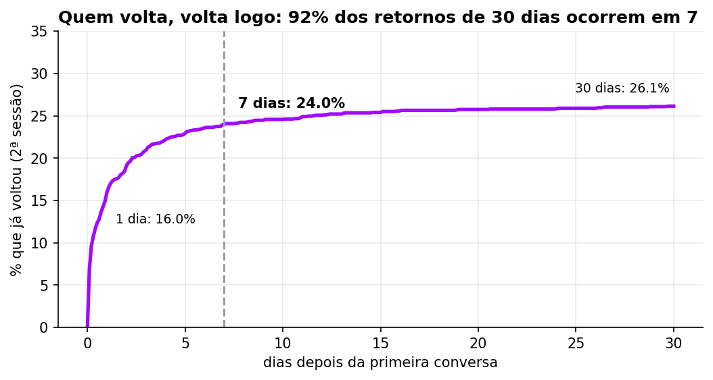
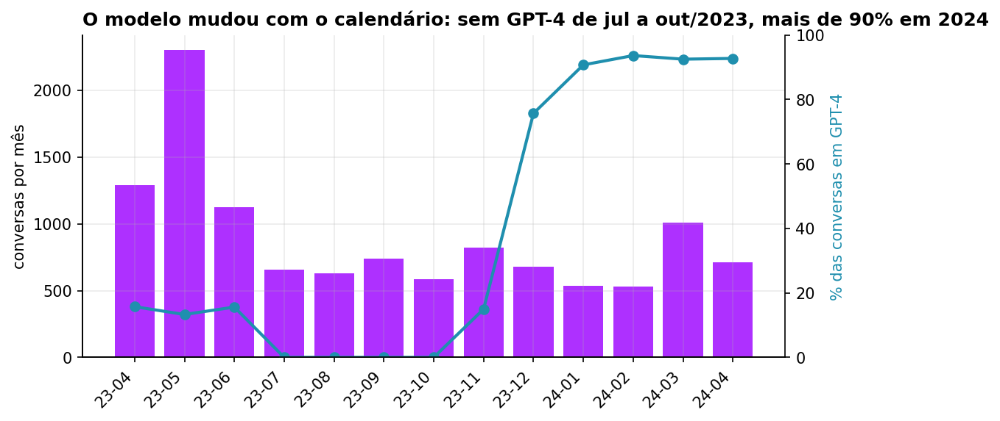
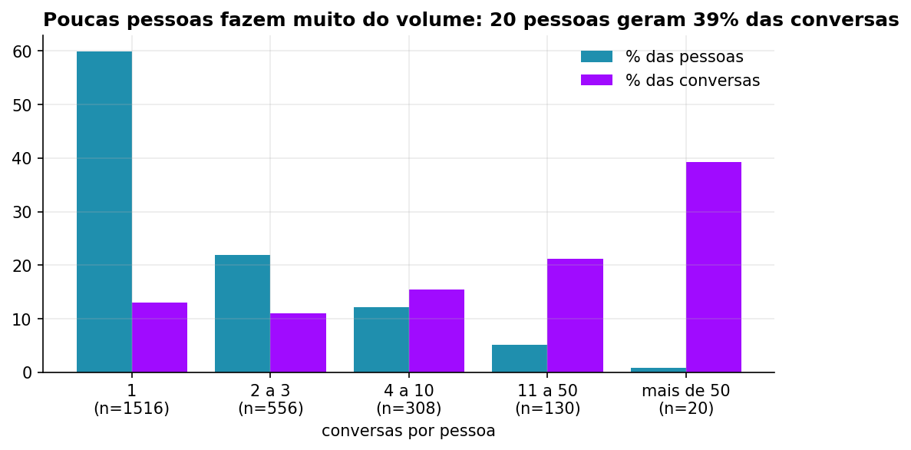
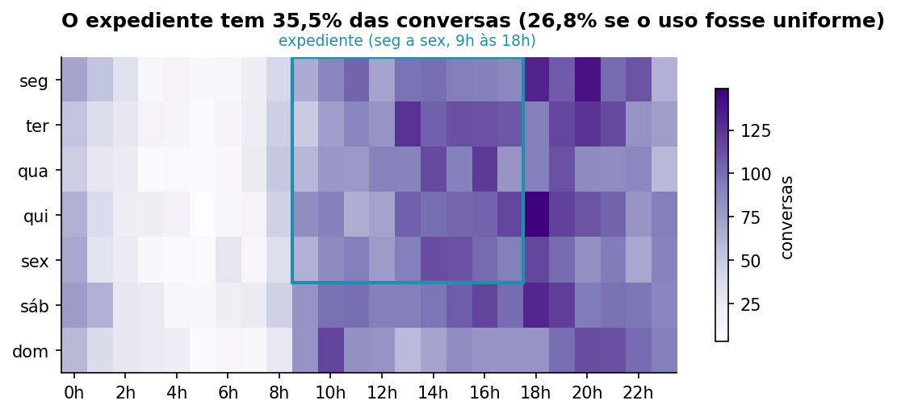
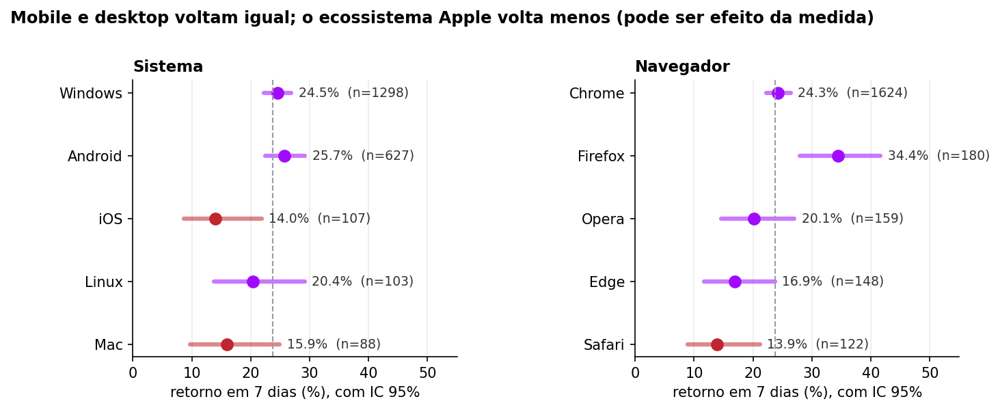
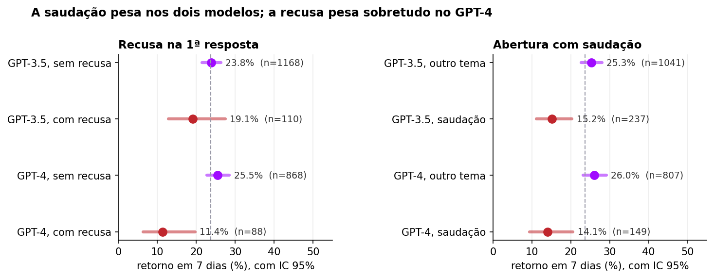
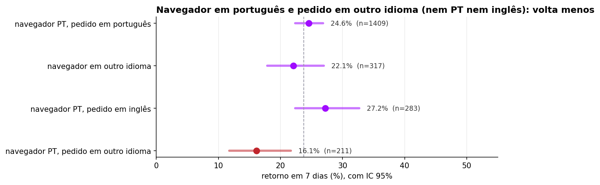

# Análise exploratória: o que os dados mostram além do número principal

Complemento do `docs/DOCUMENTO.md` (PDF, seção 3.1). **Cada figura sustenta uma conclusão** e termina com o que fazemos com ela. Base: conversas do Brasil (11.621 conversas, 2.530 pessoas, 2.234 elegíveis),
08/04/2023 a 29/04/2024, fuso de São Paulo. As figuras são geradas por `python analise/06_eda_figuras.py` (com o `docker compose up` ativo).

> **Como ler os números.** Olhei cerca de 15 recortes. Os intervalos de confiança abaixo são os de cada comparação **isolada, sem ajuste e sem correção para múltiplos testes**: são **hipóteses**, não achados.
> Os efeitos ajustados e corrigidos estão no `docs/bdr/BDR-004`. Quando uma conclusão muda um achado, está dito.

## 1. Quem volta, volta logo

**O que vemos** (cada ponto usa as pessoas que já tiveram esse tempo para voltar, no mínimo 7 dias: 2.234 até o ponto de 7 dias, 2.181 no de 14 e 2.039 no de 30): **15,9%** voltam em até 1 dia, 20,8% em 3, **23,7% em 7** (o mesmo número do cartão de retorno), 25,3% em 14 e 26,1% em 30. Entre as 2.039 pessoas com 30 dias completos, das que voltam em até 30 dias, **92% já voltou em 7** e metade volta em cerca de **14 horas** (mediana de 0,6 dia).
**Conclusão:** a janela de 7 dias é adequada (14 dias muda o retorno em só +1,6 pp) e a decisão de voltar se dá **nas primeiras horas**.
**O que fazemos:** sugerir o indicador **"voltou em 24 horas"** (16,0%) como sinal precoce no painel, e pensar qualquer ação de reengajamento dentro do primeiro dia.

## 2. O modelo mudou com o calendário, e "GPT-3.5" não é um bloco só

**O que vemos:** GPT-4 é 13 a 16% das conversas de abr a jun/2023, **0% de jul a out**, 15% em nov, 76% em dez e **91 a 94% de jan a abr/2024**. Dentro de cada família há versões muito diferentes:

| Versão do modelo (Brasil) | Conversas | Recusa na 1ª resposta | Tamanho médio da resposta |
|---|---:|---:|---:|
| gpt-3.5-turbo-0301 | 3.971 | **13,1%** | 880 caracteres |
| gpt-3.5-turbo-0613 | 3.593 | 3,8% | 1.253 |
| gpt-3.5-turbo-0125 | 157 | 2,5% | 1.040 |
| gpt-4-0314 | 684 | 6,3% | 1.895 |
| gpt-4-1106-preview | 1.882 | 7,6% | 1.966 |
| gpt-4-0125-preview | 1.334 | 4,7% | 2.133 |

**Conclusão:** modelo e época andam juntos, então **não dá para separar o efeito do modelo do efeito do calendário** só com a família (o ajuste usa o mês de chegada, mas a sobreposição é de 67%). A versão 0301 recusa 3,4 vezes mais que a 0613.
**O que fazemos:** manter o aviso sobre o modelo no documento e sugerir a **taxa de recusa por versão do modelo** como indicador.

## 3. Poucas pessoas fazem muito do volume

**O que vemos:** 59,9% das pessoas têm **uma** conversa (13% do volume); **20 pessoas (0,8%) fazem 39,2%** das conversas e 150 (5,9%) fazem 60,4%. A pessoa mais ativa tem 1.556 conversas em 129 dias de atividade, com **89% de pedidos distintos** (parece uso humano intenso).
A segunda tem 646 conversas em 21 dias, com só **39% de pedidos distintos** e mediana de 2 minutos entre conversas (**repetitivo e rápido, compatível com automação**; não dá para afirmar). Os dias de pico são dela e de poucas outras: em 25 a 39% das conversas dos quatro dias mais cheios, o autor é a pessoa mais ativa do dia.
**Conclusão:** **volume não é gente.** O "uso diário" por conversas engana; por pessoas é mais estável. O retorno quase não muda sem os 10 mais ativos (−0,3 pp), então a métrica principal está protegida.
**O que fazemos:** sugerir **"pessoas ativas" no lugar de conversas** no gráfico de uso e um **alerta de uso concentrado ou possivelmente automatizado**.

## 4. Quando usam: diurno e começo da noite, sem diferença no fim de semana

**O que vemos:** a comparação certa é com o uso **uniforme** (igual em todas as horas da semana). O expediente (seg a sex, 9h às 18h) é 45 das 168 horas (26,8%) e tem **35,5%** das conversas: **acima** do esperado. A madrugada (22h às 6h) é 8 de 24 horas (33,3%) e tem **20,1%**: **abaixo**. O fim de semana tem **29,0%** (esperado 28,6%): **sem diferença**. O pico é das 18h às 20h (6,5 a 6,8% por hora).
**Conclusão:** o uso é **diurno e do começo da noite**, sem deslocamento para o fim de semana. (Uma versão anterior deste texto dizia "noite e fim de semana, não expediente", lendo os 35,5% sem a base uniforme: era uma leitura errada e foi corrigida.) O efeito de "noite" ou "fim de semana" sobre o retorno é inconclusivo (BDR-004: fim de semana +1,8 pp [−2,9; +6,5]).
**O que fazemos:** a tela **"Quando usam"** (hora × dia, no fuso do país) compara cada faixa com o esperado. Para o cliente: escolher o horário de mensagens pelo pico real do mapa.

## 5. Dispositivo: mobile e desktop voltam igual, a Apple volta menos (e pode ser a medida)

**O que vemos:** mobile 24,0% (n=734) e desktop 23,6% (n=1.500): **+0,4 pp [−3,4; +4,1]**, sem diferença. Já iOS e Mac juntos têm **14,9%** (n=195) contra 24,6% do resto: **−9,7 pp [−15,0; −4,4]**. Por navegador: Firefox 34,4% (n=180) e Safari 13,9% (n=122).
**Cuidado:** a "pessoa" é IP + navegador. O Safari e o iPhone costumam sair por redes móveis ou por serviços que trocam o IP (como o Private Relay da Apple): **a mesma pessoa pode parecer várias**, e isso **derruba o retorno medido sem que o comportamento mude**. Não dá para separar medida de comportamento com estes dados.
**Conclusão:** não agir sobre a diferença da Apple; ela reforça o risco nº 1 do `docs/RISCOS.md` (falta um ID de usuário estável).
**O que fazemos:** sugerir uma tela **"Dispositivo e navegador"**, **com esse aviso**, e pedir ao cliente um identificador persistente.

## 6. A saudação pesa nos dois modelos; a recusa tem sinal mais nítido no GPT-4

**O que vemos** (diferenças simples dentro de cada família):
- **Saudação:** GPT-3.5 **−10,1 pp [−15,4; −4,8]** (n=237) e GPT-4 **−11,9 pp [−18,3; −5,6]** (n=149). Aparece igual nas duas famílias.
- **Recusa:** GPT-4 **−14,1 pp [−21,3; −6,9]** (n=88), mas GPT-3.5 só −4,7 pp [−12,5; +3,0] (n=110), que **inclui zero**. Por versão: no 3.5-0301 não há diferença (−0,2 pp [−12,2; +11,7], só 59 recusas); no 3.5-0613 é −9,9 pp [−19,8; 0,0].
**Conclusão:** a **saudação é o achado mais robusto** (mesmo sinal, tamanho parecido e intervalo sem zero nos dois modelos). A **recusa é um indício**: o sinal é mais nítido no GPT-4 (−14,1 pp) do que no 3.5 (−4,7 pp, intervalo com zero), mas a **diferença entre os dois modelos (−9,4 pp) não se distingue de acaso** (p ≈ 0,08), e na versão mais antiga, que recusava mais (13,1%), as pessoas voltavam igual.
**O que fazemos:** o `docs/DOCUMENTO.md` registra a saudação como o achado mais consistente (ainda um indício) e a recusa como **indício, com sinal mais nítido no GPT-4**; a decisão sobre recusas vale para os dois modelos.

## 7. Idioma do pedido contra o idioma do navegador

**O que vemos:** 22,5% das pessoas (570 de 2.530) escrevem o primeiro pedido em outro idioma que não o português, mesmo com o navegador em português. Quem escreve **em inglês** volta como o resto (27,2%, n=283, sem diferença). Quem escreve em **outro idioma** (nem português nem inglês) volta **16,1%** (n=211): **−8,5 pp [−14,0; −3,1]** contra navegador e pedido em português (24,6%, n=1.409).
**Cuidado:** o idioma da conversa é **inferido** pelo WildChat e erra (há 88 conversas do Brasil marcadas como "latim"). Pode ser ruído de detecção, ou tradução e estudo de idiomas.
**Conclusão:** hipótese a verificar, não achado. **O que fazemos:** sugerir o cruzamento **idioma do pedido × idioma do navegador** como indicador, com validação da detecção de idioma antes de agir.

## 8. Distribuições do que entra nos efeitos (Brasil, elegíveis, n = 2.234)

Para saber se os cortes de "curto" e "longo" fazem sentido, estas são as distribuições medidas (`silver.fato_usuario`) e o retorno em cada faixa, **sem ajuste** (só descrição; o ajuste está no BDR-004).

| Variável | Mediana | p90 | p99 |
|---|---|---|---|
| Turnos da 1ª conversa | 2 | 5 | 14 |
| Caracteres do 1º pedido | 60 | 992 | 15.703 |
| Caracteres da 1ª resposta | 978 | 3.039 | 4.899 |

| Faixa | Pessoas | Retorno em 7 dias |
|---|---|---|
| 1 turno | 1.034 | 20,2% |
| 2 turnos | 532 | 23,1% |
| 3 a 4 turnos | 382 | 26,7% |
| 5 ou mais turnos | 286 | 33,6% |
| 1º pedido com menos de 50 caracteres | 993 | 19,6% |
| 1º pedido com 50 a 199 | 690 | 27,5% |
| 1º pedido com 200 a 999 | 329 | 25,8% |
| 1º pedido com 1.000 ou mais | 222 | 27,0% |
| 1ª resposta com menos de 300 caracteres | 738 | 18,8% |
| 1ª resposta com 300 a 999 | 386 | 27,2% |
| 1ª resposta com 1.000 a 1.999 | 507 | 22,5% |
| 1ª resposta com 2.000 ou mais | 603 | 28,5% |

Leituras: (1) o retorno sobe com os turnos, mas turno é comportamento de quem já está engajado (BDR-004: "perfil"); (2) o 1º pedido curto (menos de 50 caracteres, em geral uma saudação) é a faixa com menor retorno; acima de 50 a taxa fica entre 26% e 28%, sem ordem clara, então "pedido longo" é, na prática, "pedido que não é só um oi"; (3) a cauda é muito longa (p99 do pedido: 15.703 caracteres, colagens de texto), o que justifica comparar faixas e não médias; (4) a resposta mais curta (menos de 300 caracteres) volta menos, mas isso mistura saudações e recusas, que têm respostas curtas; depois do ajuste o efeito da resposta longa some (+0,1 pp).

Um detalhe mecânico: quem teve **1 conversa no total** tem retorno de 0% por definição (voltar exige outra sessão); 2 a 3 conversas: 43,7%; 4 a 10: 74,8%; 11 ou mais: 88,3%. Por isso o número de conversas **nunca** entra como fator explicativo, já que é consequência do retorno.

## Resumo: o que esta exploração muda nos achados
| Achado | Antes | Depois da exploração |
|---|---|---|
| Saudação afasta | −8,1 pp (indício, não resiste à correção de 16 testes) | **mais consistente:** aparece nos dois modelos, −10 a −12 pp |
| Recusa afasta | −9,6 pp (indício) | **indício:** mais nítido no GPT-4 (−14 pp) que no GPT-3.5 (−5 pp), mas a diferença entre modelos não se distingue de acaso |
| Modelo não ajuda | −0,6 pp | sem mudança; mas "GPT-3.5" tem versões muito diferentes (recusa de 2,5% a 13,1%) |
| A janela de 7 dias | premissa | **sustentada:** 92% dos retornos de 30 dias ocorrem em 7 |
| Volume de uso | conversas | **pessoas**: 0,8% das pessoas fazem 39% das conversas |

## Onde cada sugestão está no painel
| Sugestão | Onde | Observação |
|---|---|---|
| Voltou em 24 horas e a curva de retorno | **Coortes** (a curva, com os marcos de 24 h, 7 e 30 dias) | cada ponto usa as pessoas que já tiveram esse tempo para voltar (no mínimo 7 dias), então o ponto de 7 dias (23,7%) é o mesmo do indicador principal |
| Pessoas ativas no lugar de conversas, alerta de uso concentrado | **Visão geral** (bloco de concentração) | o alerta dispara quando as 10 pessoas mais ativas passam de 25% das conversas (hoje: 32,3%) |
| Quando usam | **Visão geral** (mapa de calor dia × hora, fuso do país) | expediente 35,5% (esperado 26,8%), madrugada 20,1% (esperado 33,3%), fim de semana 29,0% (esperado 28,6%) |
| Dispositivo e navegador, com aviso | **O que faz voltar** (fim da tela) | o aviso de medida (IP + navegador) vem junto do gráfico |
| Recusa por versão do modelo | **Visão geral** (comparação entre modelos, com a tabela) e o GPT-4 por mês | 13,1% (3.5-0301) a 2,5% (3.5-0125) |
| Idioma do pedido × idioma do navegador | **O que faz voltar** (fim da tela), rotulado como hipótese | no painel o cruzamento usa **todos** os navegadores (3 níveis); o −8,5 pp acima é só com navegador em português |
| Saudação e recusa dentro de cada modelo | **O que faz voltar** (tabela com intervalo) | diferença simples, sem ajuste: −10,1 e −11,9 pp (saudação), −4,7 (inclui zero) e −14,1 pp (recusa) |

## Sugestões que saem da exploração
**Para o dashboard (indicadores e telas pensados depois de olhar os dados):**
1. **Voltou em 24 horas** (16,0%) e a **curva de retorno** na tela de coortes.
2. **Pessoas ativas** (e não só conversas) no gráfico de uso, com **alerta de uso concentrado ou possivelmente automatizado**.
3. Tela **"Quando usam"** (hora × dia no fuso do país).
4. Tela **"Dispositivo e navegador"**, com o aviso de que a medida pode distorcer.
5. **Recusa por versão do modelo**, ao longo do tempo.
6. **Idioma do pedido × idioma do navegador**.
7. **Avaliação da resposta pelo usuário** (curtir ou não curtir), quando existir: é o dado que falta.

**Para o assistente:**
1. **Onboarding na saudação** (o achado mais consistente): responder a "oi" com exemplos do que o assistente faz, e testar por A/B.
2. **Revisar recusas nos dois modelos**, e reduzir as falsas recusas.
3. **Cuidar de quem escreve em outros idiomas** (detecção, resposta no idioma, tradução).
4. **Pensar o reengajamento no primeiro dia**, já que metade de quem volta o faz em cerca de 14 horas.

## Limites
Amostra pequena (os intervalos têm de ±3 a ±7 pp nos subgrupos); comparações simples, sem ajuste; cerca de 15 recortes olhados, sem correção para múltiplos testes; e a "pessoa" é uma aproximação (IP + navegador), o que afeta sobretudo o dispositivo.
