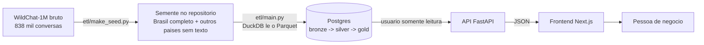

# Arquitetura

## Fluxo da base bruta até a tela

O dashboard nunca le a base bruta: ela nem existe no Postgres. Etapas do ETL: migrar, conferir semente, carregar e derivar
(usuario, sessao, variaveis; BDR-001/003), agregar, estimar efeitos, conferir qualidade.

## Componentes: local (entrega) e AWS (implantacao)
Desenho completo, rede, segurança, **custo mensal (≈ US$ 136 em São Paulo no cenário recomendado)** e Terraform em `infra/README.md`.

| Camada | Local (`docker compose up`) | AWS | Por que |
|---|---|---|---|
| Base bruta | `data/seed/*.parquet` no repo | Amazon S3 (Parquet, versionado) | Barato, imutavel, e a origem de reprocessamento |
| ETL | container `etl` (Python + DuckDB) | ECS Fargate agendada (EventBridge) | Tarefa curta e periodica; sem servidor ocioso |
| Base analitica | container `db` (Postgres 16) | Amazon RDS for PostgreSQL | Mesmo motor, backup e Multi-AZ gerenciados |
| Segredos | `.env` | AWS Secrets Manager | Sem senha no codigo |
| API | container `api` (FastAPI) | ECS Fargate atras de ALB | Escala por demanda; health check no `/api/saude` |
| Frontend | container `web` (Next.js) | CloudFront + ECS Fargate (ou Amplify) | Cache na borda; TLS |
| Cache de respostas | cabecalhos HTTP + cache em memoria da API | CloudFront (+ ElastiCache se preciso) | Ver "Performance" |
| Tema por LLM (opcional) | regras em SQL (BDR-003) | Amazon Bedrock em lote no ETL | Todo custo e LLM do dashboard ficam na AWS |
| Logs e metricas | logs JSON no stdout | CloudWatch Logs/Metrics + alarmes | Investigar numero errado (secao 4.1) |

## Modelo da base analitica em camadas (`db/migrations/001_schema_em_camadas.sql`, ADR-004)
- **Bronze** (so o ETL le): copia fiel e consultavel do bruto numa tabela unica, `bronze.wildchat` (todos os paises; o Brasil
  com texto e mensagens em JSON, os demais so metadados; `arquivo_origem` liga cada linha ao seu lote). `ops.bronze_lote` registra arquivo, sha256,
  linhas e a tabela de destino. A silver e construida a partir dela.
- **Silver** (so o ETL le): `dim_pais`, `dim_tema`, `fato_conversa` (1 linha por conversa, sem texto), `fato_usuario`
  (1 linha por usuario: primeira experiencia + `voltou_7d` + `elegivel` + `voltou_24h`, `dias_ate_voltar`, `janela_30d` e o idioma do navegador).
- **Gold** (a API le): `pais`, `agg_retorno_semana`, `agg_retorno_fator`, `efeito_fator` (resultado da analise causal), `agg_uso_dia` (uso por dia), `agg_retorno_mes_fator` (retorno por mes e perfil, base da decomposicao mix x taxa), `problema_qualidade` (conversas afetadas por cada problema de qualidade da base, tela "Glossario e qualidade"),
  `agg_curva_retorno` (% que voltou em ate d dias, base: 30 dias de janela), `agg_estrato` (saudacao e recusa dentro de cada familia de modelo), `agg_recusa_modelo` (recusa e retorno em 7 dias por versao do modelo), `agg_concentracao` (faixas de conversas por pessoa; `gold.pais` guarda a parcela dos 10 mais ativos), `agg_uso_hora` (dia da semana x hora no fuso do pais), `agg_modelo_mes` (GPT-4 por mes),
  `catalogo_indicador` (definicoes).
- **Ops**: `etl_execucao`, `bronze_lote`, `qa_resultado`.
Portao de qualidade no ETL: compara a carga com os numeros validados; falhou, faz rollback e a API nao sobe.

## Endpoints (todos aceitam `?pais=`, padrao Brazil)
| Endpoint | Entrada | Saida |
|---|---|---|
| `GET /api/saude` | - | status e ultima execucao do ETL |
| `GET /api/paises` | - | país, código ISO, fuso, idioma, tem_texto, usuários, datas |
| `GET /api/catalogo` | - | definicao, formula, denominador, SQL e fonte por indicador |
| `GET /api/retencao/coortes` | pais, inicio, fim | por semana: novos, elegiveis, voltaram_7d, taxa, IC95, aviso de amostra |
| `GET /api/retencao/fatores` | pais, fator (inclui `sistema`, `navegador`, `dispositivo` e `idioma_x_navegador`) | por nivel: elegiveis, taxa, IC95 |
| `GET /api/retencao/comparacao` | - | retorno em 7 dias de cada pais (somando as semanas) e a media geral (todos os elegiveis, ponderada por usuarios), com IC95; so paises com 30+ elegiveis |
| `GET /api/retencao/curva` | pais | pontos da curva (dias, usuarios, voltaram, taxa, IC95) e os destaques `voltou_24h`, `voltou_7d` e `voltou_30d` (base: quem tem 30 dias de janela) |
| `GET /api/retencao/estratos` | pais | saudacao e recusa dentro de GPT-4 e GPT-3.5: taxa por grupo e diferenca simples em pp com IC95 (sem ajuste) |
| `GET /api/explorar/concentracao` | pais | faixas de conversas por pessoa (1, 2-3, 4-10, 11+), parcela de pessoas e de conversas, peso dos 10 mais ativos |
| `GET /api/explorar/uso-hora` | pais | conversas por dia da semana e hora (fuso do pais), % no expediente e na madrugada |
| `GET /api/explorar/modelos` | pais | comparacao entre modelos: por familia (GPT-4 e GPT-3.5) e por versao, **retorno em 7 dias** (elegiveis) e **recusa na 1a resposta** com IC95, tamanho medio da resposta e GPT-4 por mes. Alimenta a Visao geral e a tela Explorar |
| `GET /api/uso/diario` | pais | por dia (fuso do pais): conversas e usuarios ativos |
| `GET /api/retencao/decomposicao` | pais, fator (tema, turnos, modelo, periodo do dia), de, para (meses) | variacao do retorno entre dois meses = mix + taxa + interacao (soma confere), com o detalhe por nivel; padrao: o par de meses com maior variacao |
| `GET /api/efeitos` | pais | por fator: efeito (pp), IC95, n, metodo, ajustado_por; ordenado por tamanho |
| `GET /api/qualidade` | - | execução da última carga, conferências do portão e problemas de qualidade da base (contagens) |
| `POST /api/auth/login` · `POST /api/auth/logout` · `GET /api/auth/me` | e-mail e senha | cookie de sessão HttpOnly (JWT); login com limite de tentativas |

## Telas (pergunta que cada uma responde, gráficos e por quê)
| Tela | Pergunta | Gráficos e por que esse tipo |
|---|---|---|
| **Visão geral** | "Quanto voltam, e como o uso e o perfil se distribuem?" | 8 cartões (valor + intervalo + definição; inclui voltou em 24 h e concentração do uso); painel **"O que os dados dizem"** (5 destaques em texto, gerados dos números); **curva de retorno**; **mapa de calor** dia × hora; **GPT-4 por mês**; **concentração** pessoas × conversas; **comparação entre modelos** (cartões de retorno e recusa por família, barras com IC por versão, tabela); **linha com faixa de IC por semana** (mostra tendência e incerteza juntas); **rosca** do modelo (2 partes de um todo); **barras horizontais com IC** por tema (compara categorias com nome longo); **área** do uso diário; **barras** de **todos os países com 30+ elegíveis**, em lista fixa ordenada pelo retorno (igual para qualquer país selecionado; só o destaque muda) e a média geral |
| **O que faz voltar** | "Quais fatores pesam e quanto é causa?" | **Gráfico de intervalos** ordenado pelo tamanho do efeito (ponto = efeito, barra = IC; cruzar o zero = sem efeito detectável); **barras + linha** de turnos x retorno; os 3 achados com a decisão; **tabela com ponto e intervalo** de saudação e recusa dentro de cada modelo (hipótese, sem ajuste) |
| **Coortes semanais** | "O retorno mudou ao longo do tempo, e por quê?" | 3 cartões (24 h, 7 e 30 dias); **curva de retorno** com faixa de IC (mostra que a decisão de voltar ocorre nas primeiras horas); **Barras** de novos por semana (cinza = amostra pequena); **decomposição mix x taxa** (barras divergentes: separa "mudou quem chegou" de "mudou o retorno dentro do perfil"); **mapa de calor** do retorno por semana |
| **Explorar** | "O que mais os dados deixam ver?" (exploratório, com aviso) | **Mapa de calor** dia x hora (dois eixos categóricos); **linha + barras** do GPT-4 por mês; **tabela com barras** de recusa por versão; **barras agrupadas** da concentração (pessoas x conversas) com alerta de uso concentrado; **barras com IC** por dispositivo, sistema e navegador (com aviso de medida) e por idioma do pedido x do navegador (hipótese) |
| **Glossário e qualidade** | "De onde vêm os números e o que a base tem de estranho?" | Definições, o que mostra e nunca mostra, e a **tabela de problemas de qualidade** (quantos e o que se fez) |
| **Como ler** | "Qual o papel do painel?" | Texto curto antes do primeiro gráfico |
O seletor de país, o idioma (PT/EN) e o tema (claro/escuro) ficam no cabeçalho de todas as telas.
## Performance
- **Pré-calculado no ETL (gold):** agregados por semana, por fator, por mês e perfil, uso por dia, resumo por país, efeitos estimados e problemas de qualidade. A API nunca varre as conversas: cada endpoint lê dezenas ou poucas centenas de linhas por índice (chave `pais`).
- **Medição local** (100 requisições por endpoint, `curl`, base completa de 838 mil conversas): **p50 de 6 a 9 ms e p95 de 7 a 22 ms**, máximo de 30 ms, em todos os endpoints do painel. A meta é p95 abaixo de 300 ms; o endpoint do incidente do PDF (não pré-calculado) levava 412 ms.
- **Cache (desenho; não implementado localmente, porque 20 ms dispensa):** `Cache-Control: private, max-age=300` nas respostas de agregados e, na AWS, CloudFront na frente do front estático. **Expira** quando uma carga nova termina: a API devolve `ETag` com o id da última execução do ETL (`ops.etl_execucao`), e o cache só vale para aquele id; sem carga nova, o dado não muda. Se o volume crescer, ElastiCache com a mesma chave.
- **Como se mede em produção:** cada requisição gera um log JSON (`request_id`, rota, status, `duracao_ms`); CloudWatch Metrics Insights calcula p50/p95 por rota e um alarme dispara se o p95 passar de 300 ms.
## Outros paises
`pais` e `fuso` estao em todas as tabelas. O dia/semana usa o fuso do pais (`dim_pais.fuso`); o idioma da interface e
independente do pais. Paises sem texto na semente (todos exceto Brasil) nao tem tema, recusa nem tamanhos: a tela
diz "indisponivel" e explica. Comparacao entre paises usa a mesma definicao e mostra IC de cada um.
Conversas sem pais (1.060) ficam como "Desconhecido" e fora da comparacao.
**Nome do pais na lingua da tela:** `dim_pais.iso2` (codigo ISO 3166-1, 201 dos 202; so "Desconhecido" nao tem) vai para o frontend, que escreve o nome em PT ou EN com `Intl.DisplayNames`. Um pais novo so precisa do codigo em `PAIS_ISO` (`etl/pipeline/definicoes.py`); uma conferencia do portao acusa o que ficar sem codigo. O fuso por pais (`PAISES_META`) hoje cobre cerca de 40 paises; os demais usam UTC e aparecem como "aproximado" (limite declarado).

## Privacidade: o que o dashboard mostra e nunca mostra
Mostra: agregados (contagens, taxas, efeitos com IC), por pais, semana, modelo, idioma, tema, faixa de horario.
Nunca mostra: texto de conversas, IP (nem hash), user-agent, `usuario_id`, nem celulas com menos de N usuarios
(suprimidas). A base analitica nao guarda texto: so variaveis derivadas. A API usa papel somente leitura.
