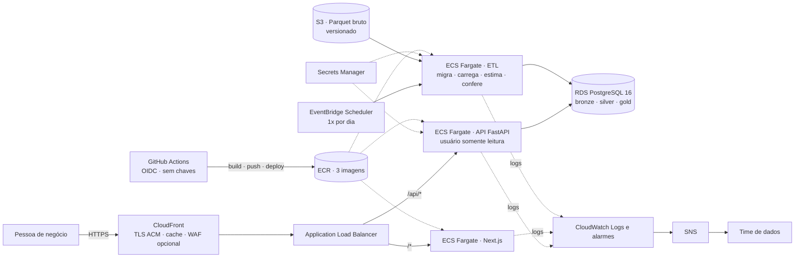

# Implantação na AWS: desenho, segurança e custo (PDF, seções 2.2 e 3.3)

A entrega roda local (`docker compose up`). Aqui está **como seria na AWS**: o que sobe, por quê, quanto custa por mês e como se opera.
Toda a infraestrutura, o custo e qualquer LLM do dashboard ficam na AWS (restrição 2.2). **Nesta versão não há LLM**: o tema e a recusa vêm de regras em SQL (BDR-003).

## Diagrama

## Componentes e por quê
| Camada | Serviço | Configuração | Por que |
|---|---|---|---|
| Borda | **CloudFront** + ACM | TLS, cache dos arquivos estáticos, WAF opcional | Franquia gratuita cobre este tráfego; é onde entra o WAF se o cliente exigir |
| Entrada | **ALB** | `/api/*` → API; o resto → web; health check em `/api/saude` | Roteia sem CORS (o front fala com a API pelo mesmo domínio) |
| Front | **ECS Fargate** (Next.js) | 2 tarefas ARM 0,25 vCPU / 0,5 GB | Sem servidor para gerir; ARM é mais barato |
| API | **ECS Fargate** (FastAPI) | 2 tarefas ARM 0,25 vCPU / 0,5 GB, papel `api_ro` (só lê a gold e o `ops`) | Escala por demanda; o dashboard **nunca lê a base bruta** |
| ETL | **ECS Fargate agendada** (EventBridge) | 1 vCPU / 2 GB, ~5 min por dia; roda **antes** de a API enxergar o dado novo | Tarefa curta e periódica: paga só os minutos; a carga é uma transação (se o portão falhar, nada é publicado) |
| Base analítica | **RDS PostgreSQL 16** | `db.t4g.small`, 20 GB gp3, criptografada, backup de 7 dias, Multi-AZ opcional | Mesmo motor do desenvolvimento (ADR-003); backup e patches gerenciados; o banco tem ~0,8 GB |
| Base bruta | **S3** | bucket privado, versionado, criptografado | Imutável, barato e é a origem de reprocessamento (a semente e, em produção, os lotes diários) |
| Imagens | **ECR** | 3 repositórios, varredura ao subir | Origem única do deploy |
| Segredos | **Secrets Manager** | senha do RDS, do `api_ro` e a chave de sessão | Nenhuma senha em código ou variável de ambiente em claro |
| Observabilidade | **CloudWatch** + SNS | logs JSON com `request_id` e `duracao_ms`, retenção de 30 dias, 6 alarmes | Investigar número errado (seção 4.1) e avisar o time antes do cliente |
| Entrega | **GitHub Actions** com OIDC | testes → build → ECR → `update-service` | Sem chave de acesso guardada no repositório |

### Rede e segurança
- **VPC em 2 zonas.** O RDS fica em sub-redes **sem rota para a internet**; só as tarefas (grupo de segurança) falam com ele na porta 5432.
- **As tarefas ficam em sub-redes públicas, com entrada só pelo ALB** (o grupo de segurança não aceita mais nada) e o ALB só aceita tráfego do CloudFront. **Decisão de custo:** isso dispensa o NAT Gateway
  (que cobra por hora e por GB). O endurecimento — tarefas em sub-redes privadas, com NAT ou endpoints de VPC — soma de US$ 35 a US$ 70 por mês (estimativa, ver "Riscos do custo") e é a primeira coisa a fazer se o cliente pedir.
- **Privacidade (LGPD):** a região é **São Paulo (`sa-east-1`)** para manter o dado no Brasil e reduzir a latência; a base analítica não guarda texto (só variáveis derivadas); o painel nunca mostra texto, IP, user-agent nem usuário.
  O texto do Brasil só existe na bronze, que só o ETL lê. Criptografia em repouso (RDS, S3) e em trânsito (TLS).
- **Acesso ao painel:** as contas ficam na tabela `ops.usuario_dashboard` (senha com scrypt) e a sessão é um cookie HttpOnly. Para o cliente, o próximo passo é SSO (Cognito ou o provedor dele).

## Como uma mudança chega à produção
1. **PR:** roda os 128 testes (`docs/TESTES.md`) e o `tsc` do front. Sem verde, sem merge.
2. **Build e push** das três imagens com a etiqueta do commit (`CODE_VERSION`), que o ETL grava em `ops.etl_execucao`.
3. **Migrações** (`db/migrations/`, numeradas e nunca editadas depois de aplicadas) são aplicadas pelo próprio ETL, antes da carga.
4. **Staging:** a tarefa de ETL roda primeiro e o **portão de qualidade** compara os números novos com os validados; só se passar a API e o front sobem (`update-service`, rolling).
5. **Produção:** mesma sequência. **Reversão:** a carga é transacional e a imagem anterior fica no ECR.
Ambientes: `dev` (local, `docker compose`), `staging` (mesma pilha, desligada à noite para economizar) e `prod`.

## Custo mensal estimado (US$, região São Paulo, 730 horas, tráfego baixo)
Preços unitários **lidos das listas oficiais da AWS** (publicadas em 04 e 11/11/2026): Fargate ARM US$ 0,0557 por vCPU-hora e US$ 0,00612 por GB-hora; ALB US$ 0,034 por hora e US$ 0,011 por LCU-hora;
Secrets Manager US$ 0,40 por segredo; CloudWatch US$ 0,90 por GB de log e US$ 0,135 por alarme. O **RDS (`db.t4g.small`, US$ 0,069 por hora, Multi-AZ US$ 0,137) vem de agregadores de preço, não do site da AWS**.

| Item | A · mínimo (1 tarefa de cada) | **B · recomendado** | C · alta disponibilidade (Multi-AZ) |
|---|---:|---:|---:|
| API (Fargate ARM 0,25 vCPU / 0,5 GB) | 12,40 | 24,80 | 24,80 |
| Web Next.js (Fargate ARM 0,25 vCPU / 0,5 GB) | 12,40 | 24,80 | 24,80 |
| ETL diário (1 vCPU / 2 GB, 5 min por dia) | 0,17 | 0,17 | 0,17 |
| ALB (hora + ~0,5 LCU médio) | 28,84 | 28,84 | 28,84 |
| RDS `db.t4g.small` | 50,37 | 50,37 | 100,01 |
| RDS armazenamento gp3 20 GB (estimado) | 4,00 | 4,00 | 8,00 |
| Secrets Manager (3 segredos) | 1,30 | 1,30 | 1,30 |
| CloudWatch (0,5 GB de logs, 6 alarmes) | 1,31 | 1,31 | 1,31 |
| ECR, S3 e Route 53 (estimado) | 0,67 | 0,67 | 0,67 |
| CloudFront e tráfego (dentro das franquias gratuitas) | 0 | 0 | 0 |
| **Total por mês** | **≈ 111** | **≈ 136** | **≈ 190** |

- **Cada execução do ETL custa US$ 0,006** (5 minutos de 1 vCPU / 2 GB).
- **Os três maiores itens são o RDS (40%), os dois serviços Fargate (37%) e o ALB (21%).** O LLM não entra: não há LLM.
- **Na região Virgínia (`us-east-1`) o cenário B custa ≈ US$ 77** (contra US$ 136 em São Paulo), mas tira o dado do Brasil: é uma decisão do cliente (LGPD) e está em `docs/RISCOS.md`.
- **Fora desta conta:** WAF (≈ US$ 5 por ACL mais US$ 1 por regra; valores de referência, não verificados), ambiente de staging (≈ US$ 111, o cenário A, se ficar ligado 24 h) e impostos.
- **Como reduzir:** exportar o front como estático para S3 + CloudFront (tira o Fargate do web, ≈ −US$ 25 no cenário B; as páginas são de cliente, mas o redirecionamento de login pede ajuste);
  compromisso de 1 ou 3 anos (Savings Plans para o Fargate, instância reservada para o RDS); e desligar o staging à noite.

### Se um dia houver LLM (Amazon Bedrock) para classificar o tema
O custo é `tokens × preço do modelo` e **o preço do modelo não foi verificado aqui**. A ordem de grandeza: o Brasil tem 11.621 primeiros pedidos (~200 tokens cada, ≈ 2,3 milhões de tokens de entrada).
Mesmo a um teto de US$ 3 por milhão de tokens de entrada e US$ 15 por milhão de saída, isso daria **≈ US$ 9** para o Brasil e **≈ US$ 630** para classificar **uma vez** os 838 mil pedidos de todos os países.
Como é uma carga única, e não recorrente, o impacto no mensal é pequeno; o que pesa é a **validação por amostra** (BDR-003), que custa tempo de pessoas.

### Riscos do custo
- O **RDS** vem de fonte secundária e o **armazenamento, o ECR, o S3, o Route 53 e o NAT** são estimativas: confirmar na [AWS Pricing Calculator](https://calculator.aws/) antes de comprometer orçamento.
- **NAT Gateway** (se as tarefas forem para sub-redes privadas): cobra por hora e por GB processado; ≈ US$ 35 a US$ 45 por mês em São Paulo é uma estimativa, não uma leitura da lista de preços.
- Tráfego e logs maiores que o suposto (0,5 GB de log por mês, 100 GB de saída) mudam o total em poucos dólares.

## Infraestrutura como código
`infra/terraform/` tem um **esboço** em Terraform da pilha acima (VPC, ECR, S3, RDS, Secrets Manager, ECS Fargate com ALB, agendamento do ETL, CloudFront e alarmes).
**Estado:** `terraform fmt` e `terraform validate` (provedor AWS 5.x) passam; **`plan` e `apply` não foram executados** (não há conta AWS neste projeto). Ponto de partida, não entrega pronta.
**Pendências conhecidas do esboço:**
1. A migração `002` cria o papel `api_ro` com a senha padrão do compose; em produção o ETL deve **ajustá-la a partir do segredo** (`ALTER ROLE api_ro PASSWORD ...`).
2. O ETL lê a semente de uma pasta (`SEED_DIR`); na AWS ela viria do S3 (`aws s3 sync` no início da tarefa, ou DuckDB lendo `s3://`).
3. O CloudFront está com cache desligado (dados dinâmicos); cachear os arquivos estáticos do front (`/_next/static`) é uma melhoria.
4. Falta o pipeline de deploy (GitHub Actions com OIDC) e o domínio/certificados, que entram como variáveis.
## Fontes dos preços
[Fargate e ECS, São Paulo](https://pricing.us-east-1.amazonaws.com/offers/v1.0/aws/AmazonECS/current/sa-east-1/index.json) ·
[ALB, São Paulo](https://pricing.us-east-1.amazonaws.com/offers/v1.0/aws/AWSELB/current/sa-east-1/index.json) ·
[Secrets Manager, São Paulo](https://pricing.us-east-1.amazonaws.com/offers/v1.0/aws/AWSSecretsManager/current/sa-east-1/index.json) ·
[CloudWatch, São Paulo](https://pricing.us-east-1.amazonaws.com/offers/v1.0/aws/AmazonCloudWatch/current/sa-east-1/index.json) ·
RDS: [Spare Cores](https://sparecores.com/database/aws/db.t4g.small) (secundária) · [Fargate, Virgínia](https://pricing.us-east-1.amazonaws.com/offers/v1.0/aws/AmazonECS/current/us-east-1/index.json) · [ALB, Virgínia](https://pricing.us-east-1.amazonaws.com/offers/v1.0/aws/AWSELB/current/us-east-1/index.json).
