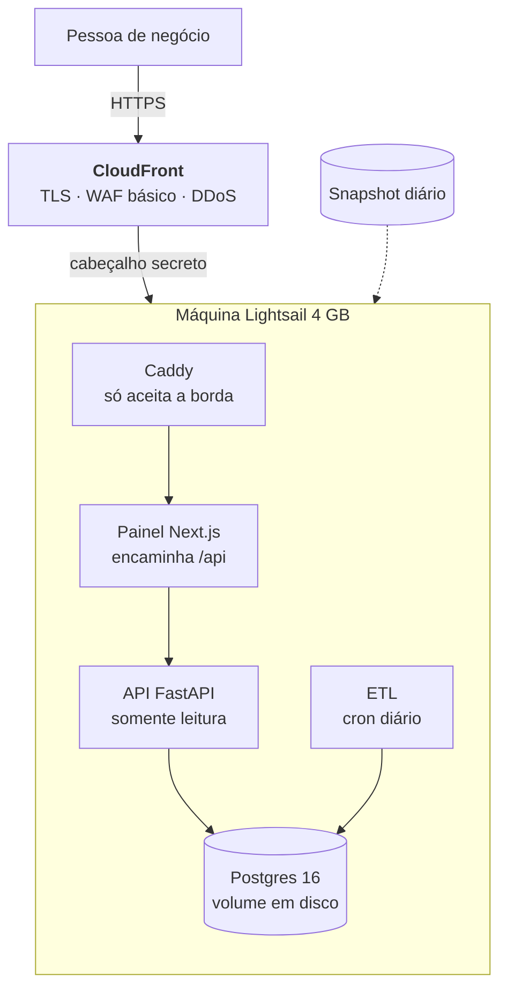
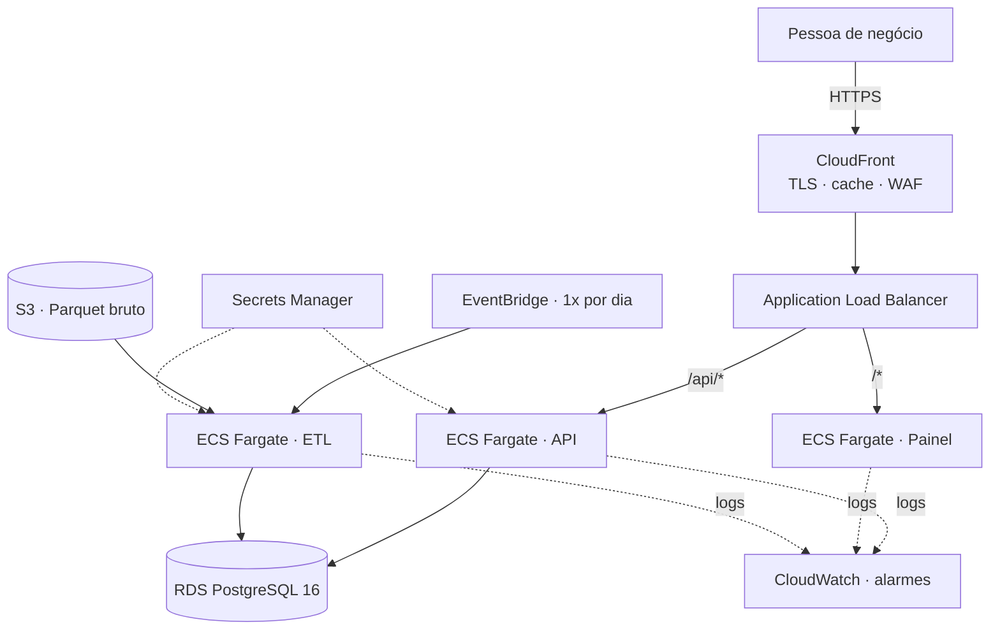

# Implantação: opções, segurança e custo (PDF, seções 2.2 e 3.3)

A entrega roda local (`docker compose up`). Aqui está **como colocar no ar**: o que sobe, por quê, quanto custa por mês e como se protege.
**Restrição do PDF (2.2):** toda a infraestrutura, o custo e qualquer LLM do dashboard ficam na **AWS**. Por isso as opções A, B e C são AWS; a D (DigitalOcean + Cloudflare) é uma **alternativa fora dessa restrição**, que só vale se o cliente a aceitar.
**Nesta versão não há LLM:** tema e recusa vêm de regras em SQL (BDR-003).

## 1. O que a aplicação precisa (medido, não estimado)
Medi a pilha completa (`docker compose`) em uma carga real de 838 mil conversas:

| Medida | Valor |
|---|---|
| Memória em repouso (banco + API + tela) | ≈ 270 MB (banco 178, tela 49, API 41) |
| **Pico durante a carga (ETL)** | **Postgres ≈ 2,8 GB** e **ETL ≈ 1,8 GB** (a API e a tela não mudam) |
| Tamanho do banco | 866 MB |
| Imagens Docker | ≈ 1,5 GB no total (ETL 840 MB, tela 337 MB, API 273 MB, Postgres 420 MB) |
| Duração da carga | de 2 a 3 minutos |
| Tráfego | baixo: o painel serve agregados pequenos (p95 de 7 a 22 ms) |

**Conclusão de tamanho:** uma máquina única precisa de **no mínimo 4 GB de RAM** (a carga é o que pesa; 2 GB não aguenta o pico) e 80 GB de disco são de sobra. Com o banco em outro servidor, a máquina da aplicação continua pedindo **4 GB** (o ETL chega a 1,8 GB) e o banco, **2 GB** (com 1 GB, não testei).

## 2. As opções

| | O que é | Custo mensal (US$) | Quando usar |
|---|---|---:|---|
| **A · simples (principal)** | **Uma máquina virtual** (AWS Lightsail, 4 GB) com tudo em `docker compose`, atrás do CloudFront | **≈ 25** | piloto e avaliação |
| **B · robusta e barata** | A máquina da aplicação **+ banco PostgreSQL gerenciado separado** (Lightsail Database, 2 GB), atrás do CloudFront | **≈ 53** (com banco em alta disponibilidade, **≈ 83**) | produção com poucos usuários |
| **C · escala** | ECS Fargate + RDS + ALB + CloudFront (o desenho anterior, com Terraform) | ≈ 111 a 190 (recomendado **≈ 136**) | muitos usuários ou exigência de rede privada |
| **D · alternativa (fora da AWS)** | DigitalOcean (Droplet + Postgres gerenciado) com **Cloudflare** na frente | **≈ 29** (só a máquina) a **≈ 59** (com banco); Cloudflare Pro soma 20 a 25 | se o cliente aceitar sair da AWS |

**Recomendação:** começar pela **A** (barata, simples de operar e suficiente para o painel). Quando o cliente passar a depender do painel, mover **só o banco** para um servidor gerenciado (**B**), sem mudar a aplicação: basta trocar a `DATABASE_URL`. A **C** fica como o caminho de escala; a **D** como plano alternativo.

## 3. Proteção na frente (o que "não pode ser esquecido")
Qualquer opção precisa de uma camada de borda entre a internet e a máquina. Em toda a AWS, ela é o **CloudFront**; na D, a **Cloudflare**.

| Proteção | AWS (CloudFront) | DigitalOcean (Cloudflare) |
|---|---|---|
| TLS e certificado | ACM, gratuito | incluído |
| **WAF** | plano **Free**: WAF básico (5 regras), US$ 0; plano **Pro**: 25 regras, **US$ 15** por mês | WAF e conjunto gerenciado gratuito, no plano **Free** (US$ 0); **Pro** US$ 25 por mês (US$ 20 no anual) |
| **DDoS** | sempre ligado em todos os planos (AWS Shield Standard) | DDoS sem limite de volume, em todos os planos |
| Bots | regras do WAF | só bots simples (Free) |
| Cota incluída | Free: 1 milhão de requisições e 100 GB por mês | Free: sem cobrança por volume |

Valores lidos nas páginas de preço do CloudFront e da Cloudflare em 16/11/2026. O plano "flat-rate" do CloudFront é recente: **confirmar no console antes de contratar**.
Se for preciso mais controle que o plano Pro, o **AWS WAF avulso** custa US$ 5 por ACL, US$ 1 por regra e US$ 0,60 por milhão de requisições (lista de preços de 14/09/2026).

**O que fazer além do WAF (vale para A, B e D):**
1. **Esconder a origem:** a máquina só responde a quem passa pela borda. O proxy reverso (Caddy) recusa (403) a requisição que não traz um **cabeçalho secreto** que só o CloudFront (ou a Cloudflare) acrescenta. Na D, também se liberam no firewall só as faixas de IP da Cloudflare.
2. **Firewall da máquina:** só 80 e 443 abertas ao mundo; **SSH (22) só por chave e só do IP do time**.
3. **Segredos fora do código:** `.env` com permissão 600 na máquina (`SESSION_SECRET`), ou o **SSM Parameter Store** (gratuito no nível padrão). Nenhuma senha no repositório.
4. **Atualizações automáticas** de segurança do sistema (`unattended-upgrades`) e imagens Docker reconstruídas a cada deploy.
5. **O que a aplicação já traz:** login com limite de tentativas (5 falhas em 5 minutos), sessão em cookie HttpOnly, API somente leitura que só enxerga a gold, painel que nunca mostra texto, IP nem usuário.
6. **Backup:** na A, **snapshot diário** da máquina (US$ 0,05 por GB por mês, ≈ US$ 1 no total); na B, backups automáticos do banco gerenciado e snapshot da máquina.
7. **Alarme:** teste de disponibilidade externo (gratuito) e alarme de CPU e disco no próprio Lightsail.

## 4. Opção A: uma máquina virtual (principal)

- **Por que Lightsail:** é a "máquina virtual simples" da AWS, com **preço fixo**, 4 TB de transferência incluídos e firewall e IP fixo prontos. Na prática é o mesmo que um Droplet da DigitalOcean, só que dentro da AWS.
- **Só a tela precisa ser exposta:** o Next.js já encaminha `/api/*` para a API por dentro da rede do Docker, então o proxy reverso fala apenas com a tela.
- **O ETL** roda por `cron`: `docker compose run --rm etl python main.py`. Como o banco guarda os dados, a execução só recarrega se houver semente nova; senão sai na hora. Em produção, a semente nova chegaria por um `aws s3 sync` antes do ETL.
- **Limite:** é **uma máquina só**. Se ela cair, o painel cai até restaurar o snapshot (perda de até 24 h de dado, que aqui é recarregável do bruto). É o preço de ser simples e barato.

## 5. Opção B: banco separado (robusta e ainda barata)
- Igual à A, mas **sem o container do Postgres**: o ETL e a API usam um **PostgreSQL gerenciado** (Lightsail Database) pela `DATABASE_URL`. O gerenciado cuida de backup, atualização e disponibilidade.
- **Banco de 2 GB** (US$ 29,43), ou **em alta disponibilidade** (US$ 58,87), com um servidor reserva que assume sozinho se o principal falhar.
- A máquina da aplicação fica **sem estado** (pode ser recriada a partir do repositório), e o banco pode crescer sem mexer nela.
- **Compatibilidade:** as migrações só usam `CREATE ROLE`, `GRANT` e gatilhos comuns (nenhum `EVENT TRIGGER` nem extensão), então não pedem superusuário. **Não verifiquei** qual versão do PostgreSQL o Lightsail oferece (a aplicação foi testada na 16): confirmar no console antes de criar.

## 6. Opção C: escala (ECS Fargate, RDS e ALB)
O desenho para quando a carga crescer ou o cliente exigir rede privada. Tem Terraform em `infra/terraform/`.

| Camada | Serviço | Configuração |
|---|---|---|
| Borda | CloudFront + ACM | TLS, WAF opcional |
| Entrada | ALB | `/api/*` para a API, o resto para o painel; health check em `/api/saude` |
| Painel e API | ECS Fargate ARM | 2 tarefas de 0,25 vCPU / 0,5 GB cada serviço |
| ETL | Fargate agendada (EventBridge) | 1 vCPU / 2 GB, ~5 min por dia |
| Base analítica | RDS PostgreSQL 16 | `db.t4g.small`, 20 GB, backup de 7 dias, Multi-AZ opcional |
| Base bruta | S3 | privado, versionado, criptografado |
| Segredos, imagens, logs | Secrets Manager, ECR, CloudWatch | |
| Entrega | GitHub Actions com OIDC | testes, build, ECR, `update-service` |

**Rede:** VPC em 2 zonas; o RDS fica em sub-redes sem rota para a internet; as tarefas ficam em sub-redes públicas com entrada só pelo ALB (isso dispensa o NAT Gateway, que custaria de US$ 35 a US$ 70 por mês, estimativa).
**Custo (região de São Paulo, 730 horas):** A·mínimo ≈ 111, **B·recomendado ≈ 136**, C·alta disponibilidade ≈ 190. O RDS pesa 40%, os dois serviços Fargate 37% e o ALB 21%. Na Virgínia (`us-east-1`) o recomendado custaria ≈ 77, mas tira o dado do Brasil (decisão de LGPD do cliente). Preços de Fargate, ALB, Secrets Manager e CloudWatch lidos das listas oficiais da AWS em 04 e 11/11/2026; o **RDS (US$ 0,069 por hora) vem de agregador de preços, não do site da AWS**.
É **10 vezes mais caro que a opção A** para o mesmo painel: só se justifica com muitos usuários.

## 7. Opção D: DigitalOcean com Cloudflare (alternativa, fora da restrição do PDF)
- **Droplet de 4 GB** (2 vCPU, 80 GB, 4 TB de transferência): **US$ 24 por mês**, mais **backups semanais a 20%** (US$ 4,80). Com Docker Compose, igual à opção A: **≈ US$ 29**.
- **Robusta:** acrescentar o **PostgreSQL gerenciado de 2 GB** (US$ 30,45, ou US$ 60,90 com 4 GB): **≈ US$ 59**. O preço do nó reserva (alta disponibilidade) **não consta na página**, então não o estimei.
- **Cloudflare na frente:** plano Free gratuito (WAF, conjunto gerenciado, DDoS sem limite); Pro US$ 25 por mês (US$ 20 no anual).
- **Por que fica em segundo lugar:** o PDF exige a AWS, e a D coloca máquina, banco e borda **fora** dela. Tecnicamente é a mesma arquitetura da A/B, com o mesmo `docker compose`, e o custo é parecido (≈ 29 contra ≈ 25).

## 8. Como colocar no ar (opção A; esboço, não testado numa conta real)
1. **Máquina:** Lightsail, Ubuntu LTS, 4 GB. IP fixo. Firewall: 80 e 443 abertos; 22 só do IP do time. Instalar Docker e Compose.
2. **Código:** `git clone` com uma *deploy key* só de leitura (o repositório é privado).
3. **Segredos:** criar `.env` (permissão 600) com `SESSION_SECRET` (valor longo aleatório) e `COOKIE_SECURE=1`. As contas de acesso já vêm da migração 029.
4. **Subir:** `docker compose up -d --build`. A primeira carga leva de 3 a 4 minutos.
5. **Proxy e TLS:** um Caddy na frente do painel (a porta 3000 já fica só em `localhost`), recusando quem não traz o cabeçalho secreto da borda.
6. **Borda:** criar a distribuição do CloudFront (plano Free) apontando para o domínio da máquina, com o cabeçalho secreto; apontar o domínio do painel para ela.
7. **Rotina:** `cron` diário para o ETL, e snapshot diário da máquina.
Para a opção B, no passo 3 basta apontar a `DATABASE_URL` para o banco gerenciado e remover o serviço `db`.

## 9. Como uma mudança chega à produção
1. **PR:** roda os 210 testes (README, seção 7) e o `tsc` do front. Sem verde, sem merge.
2. **Build e deploy:** nas opções A e B, `git pull && docker compose up -d --build` na máquina (ou GitHub Actions por SSH); na C, imagens no ECR e `update-service`. A etiqueta do commit (`CODE_VERSION`) fica em `ops.etl_execucao`.
3. **Migrações** (`db/migrations/`, numeradas e nunca editadas depois de aplicadas) são aplicadas pelo próprio ETL, antes da carga.
4. **Portão de qualidade:** o ETL compara os números novos com os validados; só se passar a carga é publicada. Uma **anomalia retém a carga** até alguém aprovar, e o painel continua com os números anteriores.
5. **Reversão:** a carga é transacional; para o código, voltar ao commit anterior (ou à imagem anterior na C).
Ambientes: `dev` (local), `staging` (a mesma pilha, ligada só quando precisa) e `prod`.

## 10. Se um dia houver LLM (Amazon Bedrock) para classificar o tema
O custo é `tokens × preço do modelo` e **o preço do modelo não foi verificado aqui**. A ordem de grandeza: o Brasil tem 11.621 primeiros pedidos (~200 tokens cada, ≈ 2,3 milhões de tokens de entrada).
Mesmo a um teto de US$ 3 por milhão de tokens de entrada e US$ 15 por milhão de saída, isso daria **≈ US$ 9** para o Brasil e **≈ US$ 630** para classificar **uma vez** os 838 mil pedidos de todos os países. É uma carga única, não recorrente; o que pesa é a **validação por amostra** (BDR-003), que custa tempo de pessoas.

## 11. Riscos do custo e o que não foi verificado
- **Lightsail (instância, banco, snapshot, transferência):** lido da lista oficial de preços da AWS, região de São Paulo, publicada em 13/11/2026. O custo mensal usa 730 horas; o Lightsail cobra por hora até o teto do plano.
- **Estimados, não lidos:** Route 53 (≈ US$ 0,50 por zona), o tamanho total dos snapshots (≈ 5 a 10 GB) e impostos.
- **Não verificados:** versão do PostgreSQL no Lightsail; o que o backup automático do banco gerenciado inclui; preço do nó reserva da DigitalOcean; limite de requisições por minuto no plano Free da Cloudflare (a página não o cita).
- **Câmbio e impostos** (IOF, nota fiscal) não estão nas contas. Confirmar tudo na [AWS Pricing Calculator](https://calculator.aws/) antes de comprometer orçamento.
- Tráfego e logs muito maiores que o suposto mudam o total em poucos dólares.

## 12. Infraestrutura como código
`infra/terraform/` tem um **esboço** em Terraform da **opção C** (VPC, ECR, S3, RDS, Secrets Manager, ECS Fargate com ALB, agendamento do ETL, CloudFront e alarmes). **Estado:** `terraform fmt` e `terraform validate` (provedor AWS 5.x) passam; **`plan` e `apply` não foram executados** (não há conta AWS neste projeto). **Para as opções A e B não escrevi Terraform:** o Lightsail tem recursos próprios (`aws_lightsail_instance`, `aws_lightsail_database`), mas a rotina da seção 8 é curta o bastante para ser feita à mão.
**Limites conhecidos do esboço da C:**
1. A migração `002` cria o papel `api_ro` com a senha padrão do compose; em produção o ETL deve **ajustá-la a partir do segredo** (`ALTER ROLE api_ro PASSWORD ...`).
2. O ETL lê a semente de uma pasta (`SEED_DIR`); na AWS ela viria do S3 (`aws s3 sync` no início da tarefa).
3. O CloudFront está com cache desligado (dados dinâmicos); cachear `/_next/static` é uma melhoria.
4. O pipeline de deploy (GitHub Actions com OIDC) e o domínio/certificados não estão incluídos.

## Fontes dos preços
- AWS Lightsail, São Paulo: [lista de preços](https://pricing.us-east-1.amazonaws.com/offers/v1.0/aws/AmazonLightsail/current/sa-east-1/index.json) (13/11/2026) · AWS WAF: [lista de preços](https://pricing.us-east-1.amazonaws.com/offers/v1.0/aws/awswaf/current/us-east-1/index.json) (14/09/2026) · [CloudFront: planos e preços](https://aws.amazon.com/cloudfront/pricing/)
- Opção C: [Fargate e ECS](https://pricing.us-east-1.amazonaws.com/offers/v1.0/aws/AmazonECS/current/sa-east-1/index.json) · [ALB](https://pricing.us-east-1.amazonaws.com/offers/v1.0/aws/AWSELB/current/sa-east-1/index.json) · [Secrets Manager](https://pricing.us-east-1.amazonaws.com/offers/v1.0/aws/AWSSecretsManager/current/sa-east-1/index.json) · [CloudWatch](https://pricing.us-east-1.amazonaws.com/offers/v1.0/aws/AmazonCloudWatch/current/sa-east-1/index.json) · RDS: [Spare Cores](https://sparecores.com/database/aws/db.t4g.small) (secundária)
- DigitalOcean: [Droplets](https://www.digitalocean.com/pricing/droplets) · [Bancos gerenciados](https://www.digitalocean.com/pricing/managed-databases) · Cloudflare: [planos](https://www.cloudflare.com/plans/)
